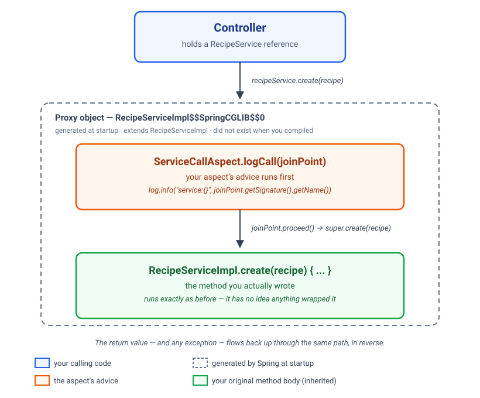

# Lombok, MapStruct & Aspects

*Write it once. Let the machine write the rest.*

*A guided lesson. Read it start to finish; work the code as you go; stop at the **Pause**
prompts and actually answer them before reading on.*

**Before you start**

- **You need the Recipe API from the REST session, finished.** If yours is not finished, or you
  were not there, copy `starting-point/recipe-api/` and work in that. It is the reference
  solution from last session, and you will not be behind.
- **Network access at the start of the session** — three new dependencies come down from Maven
  Central.
- **Java 25 · Spring Boot 4.1.1 · Maven.** Do not mix versions.
- **Sixteen checks, across three checkpoints.** Fourteen are already green from last session;
  the rest come from following each checkpoint's code.

**By the end you'll be able to:**

- Say what Lombok generates, and read it before you trust it
- Put two annotation processors in one build, in the correct order
- Replace hand-written mapping code with a generated mapper, and read the class it writes
- Decide when a mapper — or Lombok — is not the answer
- Explain why the bean you injected is not the class you wrote
- Write an aspect, put it on the right layer, and predict when it will not fire
- Say where a filter, an interceptor and an aspect each sit, and pick between them

---

## Three questions you were left with

Last session ended by asking you to look at three things and not explaining any of them.

**One.** Your controller's constructor. Two lines to declare a field and assign it, for a class
whose interesting part is the mapping and the routing underneath. Nobody enjoys typing that.

**Two.** Your DTOs' mapping methods. `CreateRecipeRequest.toRecipe()` and `RecipeResponse.from()`
— every field, typed out, once per direction. Add a field to `Recipe` next month and nothing tells
you the response forgot it.

**Three.** "Keep a record of every call into our own rules." You know how to do it — open each
service method, add one line, log it. Five methods, five edits, and you get to do it again next
time somebody adds one.

Today closes all three, and the third one teaches you something none of the others can: a call
that looks identical from the outside can mean something completely different depending on how it
was made.

---

## One — this constructor

```java
@RestController
@RequestMapping("/recipes")
public class RecipeController {

    private final RecipeService recipeService;

    public RecipeController(RecipeService recipeService) {
        this.recipeService = recipeService;
    }
}
```

Six lines to say "this class needs a `RecipeService`". Lombok generates the constructor from the
fields:

```java
@RestController
@RequestMapping("/recipes")
@RequiredArgsConstructor
public class RecipeController {

    private final RecipeService recipeService;
}
```

`@RequiredArgsConstructor` writes one constructor taking every `final` field that has not been
assigned. That is exactly the constructor injection you have been writing by hand since the
container session — which is the only reason it is safe to use here. **You are allowed to skip
typing something once you can read what it generates.**

The ones worth knowing, and nothing else today:

| Annotation | Generates |
|---|---|
| `@RequiredArgsConstructor` | A constructor for every `final` field. The one you will actually use |
| `@Getter` / `@Setter` | Accessors, per field or per class |
| `@Slf4j` | `private static final Logger log = LoggerFactory.getLogger(ThisClass.class);` |
| `@Builder` | A fluent builder |

### Two warnings, and they are not decorative

**`@Data` on an entity is a trap.** It generates `equals`, `hashCode` and `toString` across every
field. On a JPA entity — which you meet next session — that means `hashCode` changes when the id
is assigned, `toString` triggers lazy loading, and `equals` walks relationships. Use the small
annotations deliberately; do not reach for the one that does everything.

**Lombok is an annotation processor, and Java 23 stopped running those just because they are on
the classpath.** From Java 23 on it has to be named in `maven-compiler-plugin`'s
`annotationProcessorPaths` or it silently does nothing, and every generated constructor comes
back as `cannot find symbol`. When you see that error on somebody else's project in two years'
time, this is why.

**Where Lombok is not the answer:** when the constructor is doing something. If it validates,
normalises, or picks between collaborators, write it out. Lombok removes typing, not thinking.

---

## Checkpoint 1

Lombok, in the build and in two classes. **`recipe-api/README.md`, checkpoint 1.**

Tests 1 to 14 must still be green at the end of it. You changed the build, not the behaviour.

---

## Two — this mapping

```java
public Recipe toRecipe() {
    return new Recipe(null, title, cuisine, minutes, servings, ingredients, null);
}

public static RecipeResponse from(Recipe recipe) {
    return new RecipeResponse(recipe.id(), recipe.title(), recipe.cuisine(),
            recipe.minutes(), recipe.servings(), recipe.ingredients());
}
```

The same problem as the constructor, in a different shape: typing that carries no decision. Every
field, copied by hand, in both directions.

Except this one hides a real risk. **A constructor that is missing a field fails to compile.** A
mapping method that is missing a field compiles perfectly, runs, and quietly drops the data. You
will not find out until somebody asks where a value went.

### A mapper is an interface

```java
@Mapper(componentModel = "spring")
public interface RecipeMapper {

    RecipeResponse toResponse(Recipe recipe);

    List<RecipeResponse> toResponses(List<Recipe> recipes);

    Recipe toRecipe(CreateRecipeRequest request);
}
```

No body. You write **what** you want converted, not how. At compile time MapStruct writes the
class — open `target/generated-sources/annotations/.../RecipeMapperImpl.java` after your first
build and read it. It is the code you would have typed: one local variable per field, a
constructor call at the end, no reflection, nothing happening at run time that you cannot see at
compile time.

**It matches by name.** `title` on the request and `title` on the record line up on their own.
Different names need `@Mapping(source = "minutes", target = "cookTime")`; same names is the whole
reason your DTOs were shaped like the domain in the first place. Records work too — MapStruct
calls the constructor.

### The fields with no partner

`Recipe` has an `id` and an `internalNotes`. `CreateRecipeRequest` has neither — on purpose, since
the client does not choose either one.

```java
@Mapping(target = "id", ignore = true)
@Mapping(target = "internalNotes", ignore = true)
Recipe toRecipe(CreateRecipeRequest request);
```

You **say**, in writing, that they are left empty. That line is what the hand-written version
never had: a place a reviewer can look and see the decision, rather than infer it from what is
missing.

### Make forgetting a compile error

```java
@Mapper(componentModel = "spring", unmappedTargetPolicy = ReportingPolicy.ERROR)
```

Add a field to `Recipe` next month, forget to map it or ignore it, and the **build fails**, naming
the field. The problem from the start of this section, closed by the compiler instead of by
memory.

### Two annotation processors, one build

```xml
<annotationProcessorPaths>
    <path> lombok                   </path>   <!-- first  -->
    <path> lombok-mapstruct-binding </path>   <!-- second -->
    <path> mapstruct-processor      </path>   <!-- last   -->
</annotationProcessorPaths>
```

MapStruct has to see the getters and constructors Lombok generates, so Lombok has to run first.
Get the order wrong and MapStruct reports fields that do not exist — `title`, `cuisine`, all of
them, on a class where you can plainly see them.

### The mapper is a bean, and the slice does not know that

`componentModel = "spring"` puts `@Component` on the generated class, and the controller asks for
`RecipeMapper` in its constructor like any other collaborator. But `@WebMvcTest` does not scan
plain components — the same rule you are about to meet again with aspects — so a controller slice
test needs `@Import(RecipeMapperImpl.class)` to see it.

You can also test the mapper on its own, with nothing Spring about it at all:

```java
RecipeMapper mapper = new RecipeMapperImpl();
RecipeResponse response = mapper.toResponse(recipe);
```

A generated class is still just a class.

### Where a mapper is not the answer

When the conversion **decides** something — a calculation, a default, a choice between two
sources. A mapper full of `expression = "java(...)"` is a hand-written mapper written in the
wrong place. Same rule as Lombok: it removes typing, not thinking.

---

## Checkpoint 2

A mapper, and the two hand-written methods deleted. **`recipe-api/README.md`, checkpoint 2.**

Tests 1 to 16 green at the end of it — watch some of the fourteen you already had **fail first**,
because the slice cannot see the mapper until you tell it to import it.

---

## Break — 10 minutes

---

## What is aspect-oriented programming?

Here is a problem you already have, whether you have named it or not.

*"Keep a record of every call into our own rules."* You know how to do this by hand: open
`findAll`, add a line that logs it. Open `findById`, do it again. Five methods, five edits — and
the moment somebody adds a sixth method to `RecipeServiceImpl`, it goes unrecorded until somebody
notices.

**The logic is the same five times.** Only the method name changes. That is the signal for a
cross-cutting concern: a piece of behaviour that belongs to *many* places in your code at once,
rather than to any one class. Logging is the classic example. So are security checks, caching,
retrying a failed call, and transactions — you will meet the last two of those by name shortly.

**Aspect-oriented programming is a way to write that behaviour once, in one place, and tell the
framework which methods it applies to** — without editing a single line of `RecipeServiceImpl`.
The logging code and the business code stay separate, and each stays readable on its own.

### The vocabulary

Four words, and then we stop doing vocabulary.

| Word | What it is | For "record every service call" |
|---|---|---|
| **Join point** | A moment where advice could run. In Spring, always a method call | `RecipeServiceImpl.create(...)` running |
| **Pointcut** | An expression selecting join points | "every public method on `RecipeServiceImpl`" |
| **Advice** | The code that runs at a join point | Record the method name |
| **Aspect** | The class holding pointcut and advice together | `ServiceCallAspect` |

**Advice types:** `@Before`, `@After`, `@AfterReturning`, `@AfterThrowing`, and `@Around`.
`@Around` is the only one that can see both sides of the call, change the arguments, change the
return value, or decide not to call the method at all — everything else is a special case of it.
**If you can do it with `@Before`, do** — the next section starts there, on purpose, before
showing you why this session settles on `@Around` instead.

---

## The aspect that does it

Start with the simplest version there is: log a message every time a recipe is created.

```java
@Aspect
@Component
@Slf4j
public class ServiceCallAspect {

    @Before("execution(* com.sunrise.recipeapi.service.RecipeServiceImpl.create(..))")
    public void logCall(JoinPoint joinPoint) {
        log.info("a recipe was created");
    }
}
```

Read it against the table above: the string inside `@Before` is the pointcut — this one names
exactly one method, `create` — `logCall` is the advice, and the class is the aspect. `@Slf4j` is
Lombok again, from checkpoint 1 — the `Logger log = ...` field you did not have to type. Nothing
else here is new: a log line, in a method, on a class. AOP only decided which method it runs on.

Call `recipeService.create(...)` and the line prints. Call `findAll`, and nothing happens at all;
the pointcut never selected it.

Notice what `@Before` does **not** need: no `proceed()`, no return value, not even a `throws`.
Spring runs this advice, then runs `create()` itself — you never touch that call at all, only
watch it happen. That is the whole appeal of `@Before`: it is the smallest tool that does the job,
which is exactly the "if you can do it with `@Before`, do" line from the vocabulary above.

### Now widen it

Logging `create` was never the actual ask. *"A record of every call into our own rules"* means
all of them, and a sixth method added to `RecipeServiceImpl` next month should not need a sixth
aspect written for it. Widening the pointcut brings one problem with it.

**The advice type.** `@Before` can only watch a call happen. It cannot decide whether it happens,
change what it returns, or stop it. This aspect does not need any of that today — but it is about
to become the one tool this session reaches for regardless of what the rule turns out to be, and
`@Around` is the only advice type that can do everything the other four can. Standardise on it now
and there is one form to remember, not five.

```java
@Around("execution(public * com.sunrise.recipeapi.service.RecipeServiceImpl.*(..))")
public Object logCall(ProceedingJoinPoint joinPoint) throws Throwable {
    log.info("service:{}", joinPoint.getSignature().getName());
    return joinPoint.proceed();
}
```

Two changes, and neither is anything special to AOP: `create` becomes `*` — any method name — and
`@Before`/`JoinPoint` become `@Around`/`ProceedingJoinPoint`, the one that can also call the real
method rather than merely being told it happened. The log line itself barely changes: `{}` is
SLF4J's placeholder syntax, filled in from the argument that follows — here, the method's own name,
read off the join point instead of typed as a fixed string. This is the version you are about to
add to your own project:

```java
@Aspect
@Component
@Slf4j
public class ServiceCallAspect {

    @Around("execution(public * com.sunrise.recipeapi.service.RecipeServiceImpl.*(..))")
    public Object logCall(ProceedingJoinPoint joinPoint) throws Throwable {
        log.info("service:{}", joinPoint.getSignature().getName());
        return joinPoint.proceed();
    }
}
```

### Two things to get right

- **`@Component` as well as `@Aspect`.** `@Aspect` is an AspectJ annotation and Spring is not
  AspectJ. Leave `@Component` off and this compiles, deploys, and never runs. True of both versions
  above.
- **`proceed()` exactly once**, and return what it returns. This is the price of moving to
  `@Around`: it does not call the real method for you, so you must. Skip it and the real method
  never runs at all.

Notice there is still no `try`/`catch` here. If the real method throws, the exception simply
propagates — you do not have to do anything for that to work. You would only add a `catch` if you
wanted to log the failure too, and the rule then is: catch, log, **rethrow**. An aspect that
swallows a failure is worse than no aspect.

### Reading the pointcut

```
execution(public * com.sunrise.recipeapi.service.RecipeServiceImpl.*(..))
|         |      | |                                              |  |
|         |      | |                                              |  any parameters
|         |      | |                                              any method name
|         |      | the type
|         |      any return type
|         public methods only
at the moment the method runs
```

The two that catch people: `*` is one name segment, `..` is "any number of anything" — so
`(..)` is any parameter list and `service..*` is that package and everything under it.

**Name your pointcuts once you have more than one.** A `@Pointcut` method with an empty body gives
the expression a name, so the advice reads as a sentence instead of a regex — not needed yet, with
only one aspect and one rule, but worth knowing before Session 9 or 10 asks for a second one.

---

## How Spring actually makes this happen

`@Aspect` is not magic on its own — nothing about Java lets one class silently attach behaviour to
another's methods. So how does calling `recipeService.create(...)` end up running `logCall` first?

Type this into your running application and look at what comes back:

```java
System.out.println(recipeService.getClass().getName());
```

```
com.sunrise.recipeapi.service.RecipeServiceImpl$$SpringCGLIB$$0
```

That is not `RecipeServiceImpl`. It is a class that did not exist when you compiled, generated at
startup, extending yours. Every method is overridden, and every override runs your advice, then
calls `super` to reach your real code.



**This is the mechanism.** Not just for the aspect you just wrote — any behaviour Spring adds
around a method call without changing its source works this same way, and inherits the same
limits, which is why the next section matters more than it looks.

### Two ways to make the wrapper

| | Wraps | Requires |
|---|---|---|
| **JDK dynamic proxy** | An interface | The bean must have one, and only the interface's methods are advised |
| **CGLIB subclass** | The class itself | The class must not be `final`, and neither must the methods |

Boot uses CGLIB by default — **even when the class has an interface**, which is why the name
printed above is `RecipeServiceImpl$$SpringCGLIB`, not `RecipeService$$SpringCGLIB`. And because
CGLIB works by generating a subclass, a `final` class or a `final` method cannot be wrapped at
all — there is no way to override it, and Spring will not tell you it skipped it.

### Which layer, and this is the whole argument

Your aspect is going on the **service**, not the controller, and it matters:

- On the **service**, "which calls came in" means *which of my rules ran*, which is a question
  about your application.
- On the **controller**, it means every HTTP entry point, most of which just delegate straight
  through. Occasionally useful, usually not what you meant.
- On the **repository**, it means every read and write — which is genuinely useful, and which
  Spring Data gives you for free in two sessions.

A layer you can point an aspect at cleanly is a layer with a clean job.

---

## Checkpoint 3

The aspect above, added to your own project, and verified with your own eyes — call a few
endpoints and watch the console. **`recipe-api/README.md`, checkpoint 3.**

---

## Filter, interceptor, aspect — the other two ways to stand around a request

You are only building an aspect today, but the aspect only makes sense once you know what it is
not. Spring gives you three ways to run code around a request, and the only hard part is knowing
which one to reach for.

| | What it is | Sees | Knows |
|---|---|---|---|
| **Filter** | A Servlet idea, older than Spring | Every request that reaches the server, including the ones about to 404 | Raw request and response. No idea which controller |
| **Interceptor** | A Spring MVC idea | Requests that reached the MVC dispatcher | The handler — it is a parameter — and still HTTP |
| **Aspect** | A Spring container idea | Calls to any bean method | Method, arguments, return value. **Nothing about HTTP at all** |

### Two questions, asked in order

**First: does the rule need to know anything about HTTP at all** — a header, a status code, the
request or response themselves?

- **No.** Transactions, caching, retries, audit, method-level authorisation — none of them care
  whether the call came from an HTTP request, a scheduled job, or another service method calling
  in directly. **Use an aspect.**
- **Yes.** Go to the second question.

**Second — only if the first answer was yes — must it run for every request, including the ones
that never reach a controller at all**, such as a 404 or a request Spring rejects before routing
even happens?

- **Yes.** Correlation ids, access logs, CORS, compression, authentication all have to run
  whether or not routing ever succeeds. **Use a filter.** The whole of Spring Security is filters,
  which is why the security session opens there.
- **No — it only needs to run once a specific handler has been chosen.** Per-endpoint timing, a
  feature flag on one route. **Use an interceptor.**

---

## What you now know that you did not

| Before today | Now |
|---|---|
| The constructor was six lines of typing | One annotation — and you can read what it wrote |
| Mapping was every field, typed once per direction | A mapper interface, and a compile error when a field is forgotten |
| You inject the class you wrote | You inject a generated subclass that wraps it |
| Cross-cutting meant editing every method | One aspect, one pointcut, on the layer that earns it |
| Filter, interceptor and aspect looked interchangeable | Each has a different answer to "does this care about HTTP" |

### What is under the API

Every recipe you have stored today is in a `LinkedHashMap` that empties when you stop the
application. You have a repository interface with five methods, and one implementation that is a
map with a lock around it.

Next session that interface stays exactly where it is, and something else implements it.

Look at `RecipeServiceImpl` before you close it, and notice that not one line of it will have to
change for that to happen. That is what the layer was for.
