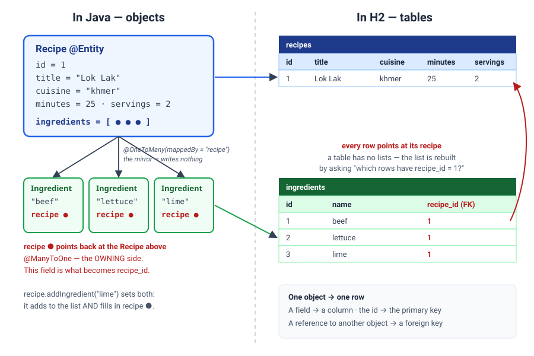
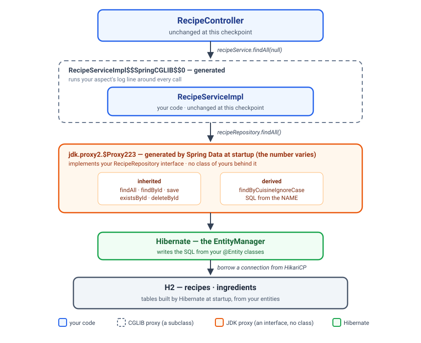

# Hibernate & JPA Mapping

*Teach Java what a table is — and teach the database what a recipe is.*

*A guided lesson. Read it start to finish; work the code as you go; stop at the **Pause**
prompts and actually answer them before reading on.*

**Before you start**

- **Work in this session's `recipe-api/` folder.** It is last session's finished Recipe API,
  copied here under a new artifact name, `recipe-api-jpa`. Nothing from today is in it yet — you
  add all of it — so it does not matter whether you finished last time.
- **Network access at the start of the session** — four new dependencies come down from Maven
  Central.
- **Java 25 · Spring Boot 4.1.1 · Maven · H2.** Nothing to install today: H2 is a database that
  runs inside your application. **For next session, have PostgreSQL installed** — that is when the
  application moves to it.
- **Twelve checks, across four checkpoints.** All twelve are already green from last session.
  Today's job is to keep them green while everything underneath them changes.

**By the end you'll be able to:**

- Say what JPA is, what Hibernate is, and why there are two names for one job
- Configure a database, Hibernate and a connection pool with a few lines of properties
- Turn a class into an entity, and explain why an entity cannot be a record
- Map a one-to-many relationship, and say which side owns it
- Replace a hand-written repository with a Spring Data interface, and say what writes the class
- Ask the repository a question with a method name, and return a long list a page at a time
- Read Hibernate's SQL log, and spot the N+1 problem in it

---

## Who you are building for today

**Sunrise Kitchen** has noticed something: *"every time you restart the server, every recipe we
added is gone."*

They are right. Every recipe lives in a `LinkedHashMap` inside `InMemoryRecipeRepository`. A map
lives in memory, and memory is wiped when the program stops. What they need is a **database** —
something that keeps data on its own, whether your program is running or not.

Fixing that takes two sessions:

- **Today:** teach Hibernate what a recipe *is* — which table, which columns, how its
  ingredients hang off it — and then switch the application from the map to a database.
- **Next session:** move to PostgreSQL, so the data survives a restart, and let a migration tool
  own the tables.

Today's database is H2, in memory. It still forgets on restart — but by the end of the session
every recipe is a real row in a real table, written by SQL you can read in the log.

---

## Objects and tables do not fit

Your Java code thinks in **objects**. A database thinks in **tables**. They are not the same shape.

| In Java | In a database |
|---|---|
| An object | A row |
| A field | A column |
| A reference to another object | A foreign key — a column holding the other row's id |
| A `List<Ingredient>` inside a recipe | **Nothing.** A table has no lists. The ingredients are rows in another table, each pointing back |
| `new Recipe()` — it exists immediately | A row exists only after an `INSERT` |
| Identity: `==`, the same object in memory | Identity: the primary key |

That last-but-one row is the hard part. A recipe *has* a list of ingredients in Java; in the
database there is no list anywhere. There is a second table, and each ingredient row carries the id
of the recipe it belongs to.

Translating between the two by hand looks like this — and this is only *reading one recipe*,
without its ingredients:

```java
PreparedStatement statement = connection.prepareStatement(
        "select id, title, cuisine, minutes, servings from recipes where id = ?");
statement.setLong(1, id);
ResultSet row = statement.executeQuery();
if (row.next()) {
    Recipe recipe = new Recipe();
    recipe.setId(row.getLong("id"));
    recipe.setTitle(row.getString("title"));
    recipe.setCuisine(row.getString("cuisine"));
    recipe.setMinutes(row.getInt("minutes"));
    recipe.setServings(row.getInt("servings"));
}
```

Now write the same again for saving, updating, deleting and listing — for every class, forever. That translation has a name:
**object–relational mapping**, or **ORM**. It is exactly the kind of work you stopped doing by hand
last session.

---

## JPA is the rulebook, Hibernate does the work

Two names come up constantly, and they are not two competing tools.

- **JPA — the Jakarta Persistence API** — is a *specification*. It is a set of annotations
  (`@Entity`, `@Id`, `@OneToMany`) and interfaces (`EntityManager`) that say *what* an ORM must
  do. It is only a rulebook: you cannot run a specification.
- **Hibernate** is an *implementation*. It is the library that reads those annotations, writes the
  SQL, and runs it.

This is the same idea you met in the first session: program to the specification, and the
implementation can change underneath. Look at your imports today — **every annotation you write
comes from `jakarta.persistence`**, not from Hibernate. Your code speaks JPA. Hibernate is the
one listening.

> **Pause.** Hibernate is not the only JPA implementation — EclipseLink is another. If your
> project switched to it next year, which of today's files would have to change?

*None of the entities.* They only use `jakarta.persistence`. That is what the specification buys
you.

---

## Hibernate in a Spring Boot application

In a plain Java project, Hibernate needs a configuration file, a session factory, and a page of
setup. Spring Boot does all of that from one starter and a few properties.

### The starters

```xml
<dependency>
    <groupId>org.springframework.boot</groupId>
    <artifactId>spring-boot-starter-data-jpa</artifactId>
</dependency>
<dependency>
    <groupId>com.h2database</groupId>
    <artifactId>h2</artifactId>
    <scope>runtime</scope>
</dependency>
```

`spring-boot-starter-data-jpa` brings Hibernate, the JPA annotations, and a connection pool. `h2`
is the database itself — a Java library that runs *inside* your application. You will never import
it, so it is `runtime` scope. H2 is where you learn. **Next session the application moves to
PostgreSQL**, and nothing in your Java code changes.

### The properties

```properties
spring.datasource.url=jdbc:h2:mem:recipes
spring.datasource.username=sa
spring.datasource.password=

spring.jpa.hibernate.ddl-auto=create-drop
spring.jpa.show-sql=true
spring.jpa.properties.hibernate.format_sql=true
```

Two families, and the prefix tells you which:

- **`spring.datasource.*`** — *where* the database is. `jdbc:h2:mem:recipes` means: H2, in
  memory, a database called `recipes`. For PostgreSQL — next session — this line names a server
  and a port instead.
- **`spring.jpa.*`** — *how Hibernate behaves*. `show-sql` prints every SQL statement it sends,
  and `format_sql` makes them readable. Leave both on while you learn: the log is where you see
  what Hibernate actually does.

### `ddl-auto` — who creates the tables

**DDL** is the SQL that defines tables: `CREATE TABLE`, `ALTER TABLE`, `DROP TABLE`.
`ddl-auto` decides whether Hibernate writes it for you, from your entities.

| Value | At startup Hibernate… |
|---|---|
| `create-drop` | Creates every table from the entities, and drops them when the app stops. **Today's setting** |
| `create` | Drops and re-creates every table. Every row is gone |
| `update` | Tries to *alter* tables to match the entities. Never drops a column, and guesses the rest |
| `validate` | Creates nothing. Checks the tables match the entities, and refuses to start if they do not |
| `none` | Does nothing at all |

`create-drop` is perfect for learning: change an entity, restart, and the tables follow. It is
also why this cannot be how a real application runs — *every restart throws the data away*.
**Next session this switches to `validate`,** and a proper migration tool takes over creating the
tables. Remember that `update` exists, and remember not to use it on a database you care about.

### The connection pool

Opening a connection to a database is slow. It is a network connection, a login, and a session set
up on the server — tens of milliseconds before your first query runs. Opening one for every request
would spend more time connecting than working, and a busy server would open thousands.

A **connection pool** solves it by opening a small number of connections **once** and reusing them:

1. At startup the pool opens some connections and keeps them.
2. A request needs the database: it **borrows** a connection from the pool.
3. It runs its queries.
4. It **gives the connection back** — the connection stays open, ready for the next request.

Your code never sees this. When Hibernate "opens" a connection it is really borrowing one, and when
it "closes" it, the connection goes back to the pool instead of being shut.

A pool does a second job that matters just as much: **it is a limit.** A database can only serve so
many connections at once. With a pool of ten, your application can never use more than ten — the
eleventh request **waits its turn** instead of pushing the database over.

Spring Boot's pool is **HikariCP**, and it is already on your classpath — the JPA starter brought
it. You do not configure it to make it work; the startup log shows it:

```
HikariPool-1 - Starting...
HikariPool-1 - Added connection conn0: url=jdbc:h2:mem:recipes user=SA
HikariPool-1 - Start completed.
```

#### The settings that matter

Every one is `spring.datasource.hikari.<name>`. Times are in milliseconds.

| Setting | Default | What it means |
|---|---|---|
| `maximum-pool-size` | 10 | The most connections the pool will ever hold. **The one that matters most** |
| `minimum-idle` | same as maximum | How many it keeps open even when nobody is asking. Leave it alone |
| `connection-timeout` | 30000 | How long a request waits for a free connection before giving up with an error |
| `max-lifetime` | 1800000 (30 min) | No connection lives longer than this. It is retired and replaced, quietly |

The exercise sets two of them:

```properties
spring.datasource.hikari.maximum-pool-size=5
spring.datasource.hikari.connection-timeout=5000
```

At most five connections, and a request waits at most five seconds for one. A request that fails
after five seconds with a clear message is kinder than one that hangs for thirty.

#### How big should the pool be?

Smaller than you think. **Bigger is not faster.** Ten connections each doing real work beat a
hundred connections fighting over the same disk and the same processors. Start with the default of
10; Hikari's own rule of thumb is roughly *twice the number of processor cores on the database
server, plus one*. Then measure.

#### What it looks like when the pool runs out

Every connection is borrowed and one more request arrives. It waits for `connection-timeout`, then
fails:

```
java.sql.SQLTransientConnectionException: HikariPool-1 - Connection is not available,
request timed out after 5000ms (total=5, active=5, idle=0, waiting=0)
```

`total=5`: the pool is at its maximum. `active=5`: every one is in use. `idle=0`: none is free.
Nearly always this does **not** mean the pool is too small. It means something is holding
connections for too long: a slow query, or code that borrowed one and never gave it back.

*The rest — every setting, pools across several instances, finding a leak, and the pool's own
debug log — is in **Extra learning material — the connection pool in depth**, at the end.*

### A window into the database

```xml
<dependency>
    <groupId>org.springframework.boot</groupId>
    <artifactId>spring-boot-h2console</artifactId>
</dependency>
```

```properties
spring.h2.console.enabled=true
```

With the application running, **http://localhost:8080/h2-console** is a web page for looking at
tables and running SQL by hand. In Spring Boot 4 it lives in its own module — without that
dependency the property does nothing, and the page is a 404.

---

## Checkpoint 1

Hibernate, H2 and the pool in the build; the properties in place; the application starts.
**`recipe-api/README.md`, checkpoint 1.**

Twelve green, the pool's `Start completed` line in the log, and an empty database in the H2
console.

---

## An entity

An **entity** is a class Hibernate knows how to store: one object, one row.

```java
@Entity
@Table(name = "recipes")
@Getter
@Setter
@NoArgsConstructor
public class Recipe {

    @Id
    @GeneratedValue(strategy = GenerationType.IDENTITY)
    private Long id;

    @Column(nullable = false, length = 100)
    private String title;

    @Column(nullable = false, length = 50)
    private String cuisine;

    private int minutes;

    private int servings;

    private String internalNotes;
}
```

| Annotation | Means |
|---|---|
| `@Entity` | Hibernate: this class is stored. Without it, nothing else here matters |
| `@Table(name = "recipes")` | The table's name. Leave it out and the table is called `recipe` |
| `@Id` | This field is the primary key. Every entity needs exactly one |
| `@GeneratedValue(strategy = IDENTITY)` | The **database** hands out the id, counting up, when the row is inserted |
| `@Column(nullable = false, length = 100)` | Shapes the column: `varchar(100) not null` |
| *(nothing)* | Still a column. Every field is stored unless you say otherwise |

Two things happen without an annotation. `minutes` becomes a column called `minutes` —
**every field is a column by default**. And `internalNotes` becomes `internal_notes`: Spring
Boot's naming turns `camelCase` into `snake_case`, which is how database people name things.

### The id is a `Long` now, and the database chooses it

In the REST session the map handed out ids as strings — `"1"`, `"2"`. Now the database does it.
`IDENTITY` means: insert the row without an id, and let the database's own counter fill it in.
Hibernate reads the new id back and sets it on your object.

It is a `Long`, not a `long`, on purpose: **a new recipe has no id yet**, and `null` is how you
say that. A `long` would be `0`, which looks like a real id.

That one change — `String` to `Long` — is why checkpoint 2 touches every layer. Everything that
passed an id around passes a different type now.

### Why an entity cannot be a record

You have used records for everything since the modern-Java session. Not here.

Hibernate builds an object from a row in two steps: **create it empty, then fill in the fields**.
That needs two things a record does not have:

- **A constructor with no arguments.** A record only has the one that takes every field.
- **Fields that can be set after the object exists.** A record's fields are `final`.

And Hibernate goes further: it may hand you a *stand-in* object — a subclass it generated — that
loads its real data later. A record is `final`, so it cannot be subclassed.

So an entity is an ordinary class: `@NoArgsConstructor` for Hibernate, `@Getter` and `@Setter`
for everyone.

> **Pause.** The DTOs are still records: `CreateRecipeRequest`, `RecipeResponse`. Why is that
> fine?

*Hibernate never sees them.* They are the wire format. Records are still the right tool for data
that is built once and never changes; an entity is neither.

### Lombok on an entity — the small annotations

Last session warned about **`@Data` on an entity**. Here is the reason, now that you can see it.
`@Data` writes `equals`, `hashCode` and `toString` using *every field*. On `Recipe` that includes
`ingredients`:

- `toString()` prints the ingredients, and each ingredient prints its recipe, which prints its
  ingredients… until the stack overflows.
- `hashCode()` changes the moment the database assigns the id, so a recipe put into a `HashSet`
  before saving cannot be found in it afterwards.

`@Getter`, `@Setter`, `@NoArgsConstructor`. Nothing that does everything.

### An aside: enums

If `cuisine` were an enum — `KHMER`, `ITALIAN` — you would add one annotation:

```java
@Enumerated(EnumType.STRING)
private Cuisine cuisine;
```

**Always `STRING`.** The default stores the enum's *position* — `0`, `1`, `2` — and the day someone
adds `FRENCH` at the top of the list, every row in the table silently changes meaning. Our cuisine
stays a `String` today: the client sends free text, and the tests already expect it.

---

## Two tables, one relationship

The client's rule: *"a recipe has a list of ingredients; every ingredient belongs to exactly one
recipe; delete a recipe and its ingredients go with it."* That is a **one-to-many**: one recipe,
many ingredients.

```java
@Entity
@Table(name = "ingredients")
@Getter
@Setter
@NoArgsConstructor
public class Ingredient {

    @Id
    @GeneratedValue(strategy = GenerationType.IDENTITY)
    private Long id;

    @Column(nullable = false, length = 100)
    private String name;

    @ManyToOne(fetch = FetchType.LAZY, optional = false)
    @JoinColumn(name = "recipe_id")
    private Recipe recipe;
}
```

And on `Recipe`:

```java
@OneToMany(mappedBy = "recipe", cascade = CascadeType.ALL, orphanRemoval = true)
@OrderBy("id")
private List<Ingredient> ingredients = new ArrayList<>();

public void addIngredient(String name) {
    ingredients.add(new Ingredient(name, this));
}
```



### Two ends, one relationship

Read the picture from the database side. There is **one** fact stored: the `recipe_id` column in
`ingredients`. Java shows that one fact from both ends:

- **`Ingredient.recipe`** — `@ManyToOne`: many ingredients, one recipe. This field **is** the
  foreign key. It is called the **owning side**, because what is in this field is what Hibernate
  writes to the database.
- **`Recipe.ingredients`** — `@OneToMany(mappedBy = "recipe")`: the same relationship seen from
  the recipe. `mappedBy = "recipe"` says *"do not store anything for me — look at the `recipe`
  field on `Ingredient`."* It is the mirror.

Here is the consequence, and it is the most common JPA bug there is: **if you only add an
ingredient to the list, and never set its `recipe` field, Hibernate stores nothing useful.** The
list is the mirror; the mirror is not written. That is what `addIngredient` is for — it sets both
ends in one call. Make it the only way anyone adds an ingredient.

> **Pause.** Checkpoint 2 has you delete `mappedBy = "recipe"` on purpose and restart. Before you
> do: what do you think Hibernate will build?

### The other settings on that line

- **`cascade = CascadeType.ALL`** — whatever you do to a recipe, do to its ingredients. Save a
  recipe and its ingredients are saved; delete it and they are deleted. You never save an
  ingredient on its own.
- **`orphanRemoval = true`** — an ingredient taken *out* of the list is deleted from the table.
  Without it, it would stay in the table, pointing at a recipe that no longer lists it.
- **`@OrderBy("id")`** — a table has no order. Unless you ask, the ingredients can come back in any
  order at all. This asks for them in the order they were added.

### `LAZY` — loaded when you touch it

`fetch = FetchType.LAZY` on the `@ManyToOne` says: when you load an ingredient, do not load its
recipe until someone calls `getRecipe()`. The `@OneToMany` list is lazy already, by default:
loading a recipe does **not** load its ingredients until something reads the list.

Lazy is the right default — you do not want to drag half the database into memory to show one
title. It has a price, and you will see it in the log before the session ends.

---

## Break — 10 minutes

---

## Checkpoint 2

The two entities, then every file that used the old record. **`recipe-api/README.md`, checkpoint
2.**

This is the long one. The moment `Recipe` stops being a record, your build is red: `recipe.id()`,
the seven-argument constructor, `withId(...)` are gone, and the id is a `Long`. Every layer has to
follow — the repository, the service, the mapper, one line of the DTO, three lines of the
controller, and the tests.

**Notice what does not change:** what the tests check over HTTP. Same URLs, same status codes, same
JSON. The client cannot tell that anything happened. That is the whole point of having DTOs between
the API and the entity.

When it is green: start the application, read the `create table` statements Hibernate printed, and
find both tables in the H2 console. They are empty — the running application still reads from the
map. The next checkpoint changes that.

---

## The repository you stop writing

Here is what you have written so far, twice: once as a map, and — if you had carried on without
Spring Data — once more with Hibernate's `EntityManager`:

```java
public Optional<Recipe> findById(Long id) {
    return Optional.ofNullable(entityManager.find(Recipe.class, id));
}

public Recipe save(Recipe recipe) {
    if (recipe.getId() == null) {
        entityManager.persist(recipe);
        return recipe;
    }
    return entityManager.merge(recipe);
}

public boolean existsById(Long id) { ... }
public void deleteById(Long id) { ... }
public List<Recipe> findAll() { ... }
```

Every entity in every project needs exactly these methods, written exactly this way. That is the
same smell as last session's constructors and mapping methods: typing that carries no
decision.

**Spring Data JPA** removes it. You write an interface, and nothing else:

```java
public interface RecipeRepository extends JpaRepository<Recipe, Long> {

    List<Recipe> findByCuisineIgnoreCase(String cuisine);
}
```

`JpaRepository<Recipe, Long>` — *a repository of `Recipe`s, whose id is a `Long`*. That line alone
gives you `findAll`, `findById`, `save`, `existsById`, `deleteById`, `count`, and a dozen more.

### Nobody wrote the class

> **Pause.** `RecipeServiceImpl` asks for a `RecipeRepository` in its constructor. There is no
> class anywhere in your project that implements `RecipeRepository`. What does Spring inject?

Put this in your running application, the same way you did with the service:

```java
System.out.println(recipeRepository.getClass().getName());
```

```
jdk.proxy2.$Proxy223
```

*(the number varies)*. A **proxy** — the same trick as last session's aspect, with one difference. The service's proxy was `RecipeServiceImpl$$SpringCGLIB$$0`:
a generated *subclass* of a class you wrote. This one is a generated object that implements your
*interface*, and there is no class of yours behind it at all. At startup Spring Data found the
interface, read its methods, and built an object that answers them.



### Why you changed two methods an hour ago

At checkpoint 2 you changed `findByCuisine` to `findByCuisineIgnoreCase`, and made `deleteById`
return nothing. At the time it looked like fuss. Now look at the service:

```java
return recipeRepository.findById(id).orElseThrow(...);
recipeRepository.findByCuisineIgnoreCase(cuisine);
recipeRepository.deleteById(id);
```

Every one of those is a method `JpaRepository` already has, with exactly that name and that
signature. So now you delete `InMemoryRecipeRepository`, add `extends JpaRepository<Recipe, Long>`
to the interface, and **the service does not change. The controller does not change. The tests do
not change.**

That is the payoff of the layers you built in the REST session: the service depended on an
*interface*, so what sits behind it can be swapped without anyone upstairs noticing.

---

## Checkpoint 3

Delete one class, change one interface. **`recipe-api/README.md`, checkpoint 3.**

Twelve green, and not one test file touched. Then add two recipes with `curl`, and find their rows
in the H2 console. The map is gone; the data is in the database.

---

## What the log shows you first

Call `GET /recipes` with two recipes stored, and read the SQL log:

```sql
select ... from recipes r1_0                                   -- 1
select ... from ingredients i1_0 where i1_0.recipe_id=?        -- 2
select ... from ingredients i1_0 where i1_0.recipe_id=?        -- 3
```

One query for the list of recipes. Then, because the ingredients are **lazy**, one more query each
time the mapper touches a recipe's ingredient list. Two recipes, three queries. A hundred recipes,
a hundred and one.

This is the **N+1 problem**: 1 query for the list, N more — one per item. Nothing is broken. The
answer is right. It is just slow in a way that grows with your data, which is exactly why it hides
until production. **The only place you can see it is the SQL log** — which is why `show-sql` stays
on while you learn.

> **Pause.** The restaurant has 400 recipes. How many queries does `GET /recipes` send?

*401.* Next session fixes it with one annotation, and you will watch them become one.

---

## Asking the repository questions

The client has two more requests: *"Show us the quick recipes. And the menu is growing — do not
send all of it at once."* Neither needs a line of SQL from you.

### A query from a method name

You have already written one:

```java
List<Recipe> findByCuisineIgnoreCase(String cuisine);
```

No body, no SQL — and it works. Spring Data **reads the method name** and writes the query from
it. That is called a **derived query**.

| Word in the name | Becomes |
|---|---|
| `find` | `select` |
| `By` | `where` |
| `Cuisine` | the `cuisine` field → the `cuisine` column |
| `IgnoreCase` | `upper(...) = upper(?)` |

```sql
select ... from recipes r1_0 where upper(r1_0.cuisine)=upper(?)
```

The parameter fills the `?`. There is one parameter for each condition, in the order the conditions
appear in the name.

### The vocabulary

The name is built from a fixed set of words. These are the ones you will use most.

**Comparing**

| Method name | Asks for |
|---|---|
| `findByCuisine(c)` | cuisine equals |
| `findByMinutesLessThan(n)` | fewer than *n* minutes |
| `findByMinutesLessThanEqual(n)` | *n* minutes or fewer |
| `findByMinutesGreaterThan(n)` | more than *n* minutes |
| `findByMinutesBetween(a, b)` | from *a* to *b*, both included — **two** parameters |
| `findByCuisineIn(list)` | cuisine is any one in the list |
| `findByInternalNotesIsNull()` | no notes at all — **no** parameter |

**Text**

| Method name | SQL | Finds |
|---|---|---|
| `findByTitleContaining("am")` | `like '%am%'` | Fish **Am**ok |
| `findByTitleStartingWith("Lok")` | `like 'Lok%'` | **Lok** Lak |
| `findByTitleEndingWith("ara")` | `like '%ara'` | Carbon**ara** |
| `findByTitleContainingIgnoreCase("AM")` | `upper(...) like upper(...)` | Fish Amok |

You pass the plain text; Spring Data adds the `%` signs.

**Joining conditions, sorting, limiting**

| Method name | Asks for |
|---|---|
| `findByCuisineAndServings(c, n)` | both must be true |
| `findByCuisineOrCuisine(a, b)` | either one |
| `findByCuisineOrderByMinutesAsc(c)` | sorted, quickest first |
| `findByCuisineOrderByMinutesDesc(c)` | sorted, slowest first |
| `findTop3ByOrderByMinutesAsc()` | only the three quickest |
| `findFirstByCuisineOrderByMinutesAsc(c)` | only the quickest one |

`OrderBy` always goes last. `Top3` and `First` go right after `find`.

**Not only `find`**

| Method name | Returns | Asks |
|---|---|---|
| `countByCuisine(c)` | `long` | how many? |
| `existsByTitle(t)` | `boolean` | is there one? |
| `deleteByCuisine(c)` | `void` | delete every match |

`existsBy` and `countBy` never load a recipe, so they are cheaper than loading a list and asking
its size.

### The return type is part of the question

| You write | You are saying |
|---|---|
| `List<Recipe> findBy…` | there may be many — or none: an empty list, never `null` |
| `Optional<Recipe> findBy…` | at most one — or none: an empty `Optional` |
| `Recipe findBy…` | exactly one — and `null` if there is none |
| `long countBy…` | a number |
| `boolean existsBy…` | yes or no |

Prefer `Optional` to a bare `Recipe`: it makes you decide what happens when nothing is found.

### Two things that catch everyone

**The name uses the Java field, not the column.** The field is `internalNotes`; the column is
`internal_notes`. The method is `findByInternalNotesIsNull`. You are still speaking Java, and
Hibernate translates.

**A wrong name stops the application from starting.**

```java
List<Recipe> findByKitchen(String kitchen);
```

```
No property 'kitchen' found for type 'Recipe'
```

Spring Data checks every method name against the entity at startup. That is a good thing: a
misspelt query can never reach a user. You find out in ten seconds.

> **Pause.** `findTop2ByCuisineIgnoreCaseOrderByMinutesAsc("KHMER")`, with Fish Amok (khmer, 45),
> Lok Lak (khmer, 25), Nom Banh Chok (khmer, 60) and Carbonara (italian, 20) stored. What comes
> back, and in what order?

*Lok Lak, then Fish Amok.* Khmer only, in any letter case, quickest first, and only two of them.

### The quick recipes

The client's first request is one line in the interface:

```java
List<Recipe> findByMinutesLessThanEqualOrderByMinutesAsc(int minutes);
```

```sql
select ... from recipes r1_0 where r1_0.minutes<=? order by r1_0.minutes
```

That name is about as long as a derived query should get. When a name grows past one line, or
needs a join, or stops reading like a sentence, stop: next session's `@Query` is the better tool.

---

## A page at a time

`GET /recipes` loads every row, builds every object and sends all of it. With three recipes nobody
notices. With four hundred, the client waits for four hundred recipes and shows ten.

The fix is **pagination**: the client asks for one page, and the *database* cuts the list — not
your Java code.

### A page is two numbers

- **page** — which page. **The first page is page 0.** Everybody gets this wrong once.
- **size** — how many on each page.

| `page`, `size` | You get |
|---|---|
| 0, 10 | recipes 1–10 |
| 1, 10 | recipes 11–20 |
| 2, 10 | recipes 21–30 |

### `Pageable` in, `Page` out

```java
Page<Recipe> findAll(Pageable pageable);
```

You do not write this method — `JpaRepository` already has it.

- **`Pageable`** is the request: which page, what size, in what order.
- **`Page<Recipe>`** is the answer: the recipes on that page, *and* how many there are in total.

You build the request with `PageRequest.of`:

```java
Pageable pageable = PageRequest.of(0, 2, Sort.by("minutes"));   // page 0, two per page, quickest first

Page<Recipe> result = recipeRepository.findAll(pageable);
```

`"minutes"` is the **field** name again, not the column. And read the log — one call sends **two**
queries:

```sql
select ... from recipes r1_0 order by r1_0.minutes fetch first ? rows only
select count(r1_0.id) from recipes r1_0
```

The first fetches only the rows on this page. The second counts every row, so the page can tell
the client "page 1 of 2". Page 1 and later add an `offset` to the first query: skip the rows that
were on the earlier pages.

What a `Page` can tell you:

| Method | Gives you |
|---|---|
| `getContent()` | the recipes on this page — a `List<Recipe>` |
| `getNumber()` | which page this is |
| `getSize()` | the size that was asked for |
| `getTotalElements()` | how many recipes exist |
| `getTotalPages()` | how many pages that makes |
| `hasNext()` | is there another page? |

### Sorting

```java
Sort.by("minutes")                              // ascending
Sort.by("minutes").descending()
Sort.by("cuisine").and(Sort.by("title"))        // cuisine first, then title
```

**Always sort when you page.** A table has no order of its own; without an `order by`, the database
may hand the same row out on two different pages and skip another completely. For the same reason,
when two recipes can have the same `minutes`, add the id as a tie-breaker:
`Sort.by("minutes").and(Sort.by("id"))`.

Any derived query can be paged or sorted too — add a `Pageable` or a `Sort` as the **last**
parameter:

```java
Page<Recipe> findByCuisineIgnoreCase(String cuisine, Pageable pageable);

List<Recipe> findByMinutesLessThanEqual(int minutes, Sort sort);
```

### Two rules, and they live in the service

```java
private static final Set<String> SORTABLE = Set.of("title", "cuisine", "minutes", "servings");

public Page<Recipe> findPage(int page, int size, String sortBy) {
    int safeSize = Math.min(size, 50);
    String property = SORTABLE.contains(sortBy) ? sortBy : "id";
    Sort sort = Sort.by(property).and(Sort.by("id"));
    return recipeRepository.findAll(PageRequest.of(page, safeSize, sort));
}
```

- **Cap the size.** `?size=100000` is "send everything" again. The service allows fifty at most.
- **Choose what a client may sort by.** Anything not on the list sorts by `id`. Without the list, a
  client could sort by `internalNotes` — and learn something about a field it is never shown.

These are decisions about recipes, not about HTTP, which is why they are in the service and not in
the controller.

### What goes back to the client

```java
public record PageResponse<T>(
        List<T> content,
        int page,
        int size,
        long totalElements,
        int totalPages) {
}
```

A DTO, for the same reason `RecipeResponse` is one: **you** decide what the JSON looks like. `Page`
is Spring's class, and its JSON shape is Spring's to change. The `<T>` means it can wrap a page of
anything; today it wraps recipes.

```json
{
  "content": [
    { "id": 4, "title": "Carbonara", "cuisine": "italian", "minutes": 20, "servings": 2, "ingredients": ["spaghetti", "guanciale", "egg", "pecorino"] },
    { "id": 3, "title": "Lok Lak", "cuisine": "khmer", "minutes": 25, "servings": 2, "ingredients": ["beef", "lettuce", "lime", "kampot pepper"] }
  ],
  "page": 0,
  "size": 2,
  "totalElements": 4,
  "totalPages": 2
}
```

### Why the page gets its own URL

`GET /recipes` answers with an **array**. A page is an **object** with the array inside it. Change
the first into the second and every client that reads the list breaks — and so do your twelve
tests. So the page is a new endpoint, `GET /recipes/page`, and the old one stays exactly as it was.

In a **new** API, page the list from the first day. Adding it later is what costs.

One shortcut to know about: Spring can build the `Pageable` for you. Declare a controller parameter
of type `Pageable`, and it is filled from `?page=0&size=2&sort=minutes,desc` with no code at all.
It is less typing — and the client can then sort by any field and ask for any size. Today you build
the request by hand so that you see each piece, and so that the two rules above stay yours.

---

## Checkpoint 4

*"Show us the quick recipes. And do not send the whole menu at once."*

One derived query, one new record, two service methods, two endpoints.
**`recipe-api/README.md`, checkpoint 4.**

Twelve green and untouched. `GET /recipes/quick?maxMinutes=30` answers quickest first;
`GET /recipes/page?size=2&sort=minutes` answers two recipes and says there are two pages. In the
log: one `select` with `fetch first`, one `count` — and the N+1 again, one query per recipe **on
the page**. Paging made that problem smaller. It did not fix it.

---

## What you now know that you did not

| Before today | Now |
|---|---|
| Recipes lived in a map | Rows in real tables, written by SQL you can read |
| JPA and Hibernate sounded like rival tools | A specification you code against, and the library that implements it |
| A connection was something that just existed | A pool lends them, limits them, and tells you when it runs out |
| A record held a recipe | An entity class — no-argument constructor, settable fields, no `@Data` |
| A recipe had a `List<String>` | Two tables, one foreign key, and a mirror list with `mappedBy` |
| A repository was a class you wrote | An interface. Spring Data writes the object |
| Every new question needed new code | A method name is the query — `findByMinutesLessThanEqualOrderByMinutesAsc` |
| `GET /recipes` sent everything | `Pageable` in, `Page` out: the database cuts the list |
| Queries were invisible | You read them in the log — and you have seen your first N+1 |

### What is still missing

Stop the application and start it again: the recipes you added are gone. H2 lives in memory, and
the tables are rebuilt from nothing at every start. The three house recipes are gone too — they
were created inside the class you deleted.

Next session fixes all of it: the application moves to **PostgreSQL**, a migration tool builds the
tables and puts the house recipes back, and the N+1 you just saw becomes one query. **Have
PostgreSQL installed before you come.**

---

## Extra learning material — testing against a real database

*Not part of the session. Work through it afterwards if you want to see how persistence code is
tested; the code is in `recipe-api/EXTRA-tests.md`.*

### A test that talks to a real database

Every controller test so far uses a **mock** repository. That tests the web layer and the service;
it says nothing about whether a recipe can actually be stored. To test the mapping you need the
opposite slice: **no web at all, and a real database.**

```java
@DataJpaTest
class RecipeMappingTest {

    @Autowired
    private TestEntityManager entityManager;
}
```

`@DataJpaTest` starts only the persistence part of Spring: Hibernate, a fresh in-memory H2
database, and the tables built from your entities. No controllers, no services. Two more things it
does for you:

- **Every test runs inside a transaction that is rolled back at the end.** Tests cannot leave rows
  behind for the next one.
- It gives you a **`TestEntityManager`** — Hibernate's own save-and-load interface, with a few
  helpers for tests.

#### Persist, flush, clear, find

Every test in checkpoint 3 has the same four steps:

```java
Long id = entityManager.persistAndGetId(amok, Long.class);  // 1. save it — it gets an id
entityManager.flush();                                      // 2. send the SQL now
entityManager.clear();                                      // 3. forget everything
Recipe found = entityManager.find(Recipe.class, id);        // 4. read it back
```

Step 3 is the one people leave out, and it is the one that matters. Hibernate **remembers every
object it has saved or loaded**. Without `clear()`, `find` hands back the very object you saved —
straight from memory, without asking the database. The test passes whether the mapping works or
not.

With `clear()`, `find` has to go to the database and build a brand-new object from the row. If a
column is wrong, the value comes back wrong. That is a real test.

---

`RecipeMappingTest` in the extra file has three tests built this way: a recipe reads back field for
field, its ingredients come back with it in order and pointing at it, and deleting a recipe deletes
its ingredients.

### Watching Hibernate work

Two things Hibernate does that you cannot see in Java code. You can only see them in the SQL log —
which is why `show-sql` stays on while you learn.

#### Asking twice, reading once

```java
Recipe first = entityManager.find(Recipe.class, id);
Recipe second = entityManager.find(Recipe.class, id);
```

Two calls. Look at the log: **one** `select`. The second `find` never reached the database — and
`second` is not just equal to `first`, it is **the same object**.

Hibernate keeps every entity it has loaded in memory for as long as the current transaction lasts.
Ask for the same id again and you get what it already has. This memory is called the
**first-level cache**, or the *persistence context*. You never switch it on; it is always there. It
is also why `clear()` matters in the tests above.

There is also a **second-level cache**, shared across transactions, which you *do* switch on — and
which has real traps. That is past today's boundary: the companion course `sunrise-springdatajpa`
(*Caching*) covers it.

#### One query becomes many — the N+1, in a test

```java
List<Recipe> recipes = /* select every recipe */;
for (Recipe recipe : recipes) {
    recipe.getIngredients().size();   // touch the list
}
```

The log:

```sql
select ... from recipes r1_0                                   -- 1
select ... from ingredients i1_0 where i1_0.recipe_id=?        -- 2
select ... from ingredients i1_0 where i1_0.recipe_id=?        -- 3
select ... from ingredients i1_0 where i1_0.recipe_id=?        -- 4
```

One query for the list of recipes. Then, because the ingredients are **lazy**, one more query each
time the loop touches a recipe's list. Three recipes, four queries. A hundred recipes, a hundred and
one.

This is the **N+1 problem**: 1 query for the list, N more — one per item. Nothing is broken. The
answer is right. The test passes. It is just slow in a way that grows with your data, which is
exactly why it hides until production.

`HibernateAtWorkTest` in the extra file has both as tests — they pass either way, and the real answer
is the number of `select` statements in the console.

---

## Extra learning material — the connection pool in depth

*Not part of the session. Read it before you run an application that real people depend on.*

### Every setting, and what each one protects you from

Every one is `spring.datasource.hikari.<name>`. Times are in milliseconds.

| Setting | Default | What it means |
|---|---|---|
| `maximum-pool-size` | 10 | The most connections the pool will ever hold. **The one that matters most** |
| `minimum-idle` | same as maximum | How many it keeps open even when nobody is asking. Leave it alone: a fixed-size pool is what Hikari recommends |
| `connection-timeout` | 30000 | How long a request waits for a free connection before giving up with an error |
| `idle-timeout` | 600000 (10 min) | How long an unused connection may sit before it is closed. Only matters when `minimum-idle` is smaller than the maximum |
| `max-lifetime` | 1800000 (30 min) | No connection lives longer than this. It is retired and replaced, quietly |
| `keepalive-time` | 120000 (2 min) | How often an idle connection is pinged so that a firewall does not drop it |
| `leak-detection-threshold` | 0 (off) | Warn when a connection has been borrowed for longer than this and not returned |
| `pool-name` | `HikariPool-1` | The name in the log lines. Worth setting when an application has more than one database |

The exercise sets two of them:

```properties
spring.datasource.hikari.maximum-pool-size=5
spring.datasource.hikari.connection-timeout=5000
```

### How big should the pool be?

Smaller than you think. **Bigger is not faster.** Ten connections each doing real work beat a
hundred connections fighting over the same disk and the same processors — past a point, every extra
connection makes the database *slower*, because it spends its time switching between them.

A sensible start is the default of 10, and Hikari's own rule of thumb is roughly *twice the number
of processor cores on the database server, plus one*. Then measure. The other number to know is the
database's own limit — PostgreSQL allows 100 connections by default — and **every copy of your
application has its own pool**.

A "copy" here means the **same application started more than once** — several *instances* of the
Recipe API running at the same time, all connected to the **same database**. That is normal in
production: one application is run as three instances so that it can serve more requests, and so
that it keeps working if one of them stops. It is not three different applications, and it is not
three databases.

The pool lives inside each running instance, so three instances mean three separate pools, and
those pools do not know about each other. `maximum-pool-size` is a limit **per instance**, not a
total:

```
Instance 1 (Recipe API)  — pool of 40 ─┐
Instance 2 (Recipe API)  — pool of 40 ─┼─>  one PostgreSQL database (allows 100)
Instance 3 (Recipe API)  — pool of 40 ─┘

3 instances x 40 = 120 connections wanted, from a database that allows 100
```

So the number to check is *instances × pool size*, and it must stay under the database's limit.
The pool size is a decision about the whole system, not one instance.

### What it looks like when the pool runs out

Every connection is borrowed and one more request arrives. It waits for `connection-timeout`, then
fails:

```
java.sql.SQLTransientConnectionException: HikariPool-1 - Connection is not available,
request timed out after 5000ms (total=5, active=5, idle=0, waiting=0)
```

Read the four numbers — they are the whole story. `total=5`: the pool is at its maximum.
`active=5`: every one is in use. `idle=0`: none is free. Nearly always this does **not** mean the
pool is too small. It means something is holding connections for too long: a slow query, or code
that borrowed a connection and never gave it back — a **leak**.

That is what `leak-detection-threshold` is for. Set it to, say, 2000, and Hikari prints a warning
with the stack trace of whoever borrowed the connection:

```
Connection leak detection triggered for conn0 on thread main, stack trace follows
java.lang.Exception: Apparent connection leak detected
```

This is also why a short `connection-timeout` is kinder than a long one: a request that fails after
five seconds with a clear message is better than one that hangs for thirty.

### Seeing the pool for yourself

Add one line, restart, and Hikari prints every setting it is actually using — defaults included:

```properties
logging.level.com.zaxxer.hikari=DEBUG
```

```
HikariPool-1 - configuration:
connectionTimeout...............5000
idleTimeout.....................600000
keepaliveTime...................120000
maxLifetime.....................1800000
maximumPoolSize.................5
minimumIdle.....................5
```

and, every thirty seconds, one line of health:

```
HikariPool-1 - Pool stats (total=5/5, idle=5/5, active=0, waiting=0)
```

Take the line out again afterwards; it is noisy.

### Other pools

You will see older projects using **C3P0** or **DBCP**. They do the same job; HikariCP replaced them
as Spring Boot's default because it is faster and has far fewer settings to get wrong. Recognise
the names; you will not need to choose them. The companion course `sunrise-springdatajpa`
(*Connection pooling*) goes deeper into sizing.

> **Pause.** Your pool has 5 connections and `connection-timeout=5000`. Six requests arrive at the
> same moment, and each needs the database for one second. What happens to the sixth?

*It waits about one second, then runs.* A connection came back before its five seconds were up.
The pool did its job: nobody failed, and the database never saw more than five.

---

## Extra learning material — who changed this, and when

*Not part of the session. Try it on your own project afterwards.*

Almost every real table grows two columns sooner or later: **when was this row created, and when
was it last changed?** Setting them by hand in every service method is exactly the cross-cutting
chore you learned to hate last session. JPA auditing does it for you.

On the entity:

```java
@Entity
@Table(name = "recipes")
@EntityListeners(AuditingEntityListener.class)
public class Recipe {

    @CreatedDate
    private Instant createdAt;

    @LastModifiedDate
    private Instant updatedAt;
}
```

And, once, on **its own** configuration class:

```java
@Configuration
@EnableJpaAuditing
public class JpaAuditingConfig {
}
```

Save a recipe and both are filled in; change it and `updatedAt` moves:

```
CREATED 2026-09-29T06:12:45.245Z  UPDATED 2026-09-29T06:12:45.245Z
CREATED 2026-09-29T06:12:45.245Z  UPDATED 2026-09-29T06:12:45.292Z
```

Three things you will meet along the way:

- **The mapper notices first.** Two new fields on `Recipe`, and last session's
  `unmappedTargetPolicy = ReportingPolicy.ERROR` stops the build: `Unmapped target properties:
  "createdAt, updatedAt"`. The client may not choose them, so they get `ignore = true`. The
  compile error you set up last session just earned its keep.
- **Why `@EnableJpaAuditing` gets its own class.** Put it on `RecipeApiApplication` instead and
  every `@WebMvcTest` fails with `JPA metamodel must not be empty`. A web slice loads the
  application class but no JPA — and the annotation demands JPA. On its own `@Configuration`
  class, the web slice never sees it.
- **"Who changed it"** — `@CreatedBy` — needs to know who is logged in. That waits for the
  security session.

Full change history — every version of every row — is a library called **Envers**. The companion
course `sunrise-springdatajpa` (*Auditing*) covers both.
