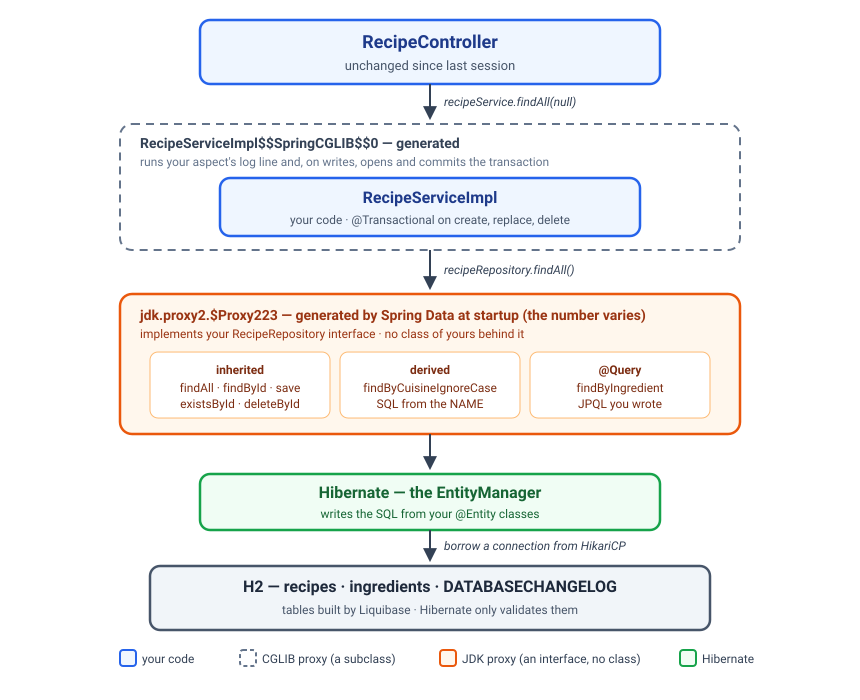

# Spring Data JPA, Liquibase & Swagger

*Delete the repository. Keep the tables. Publish the contract.*

*A guided lesson. Read it start to finish; work the code as you go; stop at the **Pause**
prompts and actually answer them before reading on.*

**Before you start**

- **You need the Recipe API from last session, finished** — the `Recipe` and `Ingredient`
  entities, the Spring Data repository, quick recipes and paging. Copy it into this session's
  `recipe-api/` folder and continue from there; that folder's `README.md` says how.
- **Network access at the start of the session** — two new dependencies come down from Maven
  Central.
- **PostgreSQL installed and running on your machine**, for checkpoint 2. You start on H2, as
  last session, and move to PostgreSQL halfway through.
- **Java 25 · Spring Boot 4.1.1 · Maven · H2, then PostgreSQL.**
- **Four checkpoints.** `mvn test` is green when you start and green at the end of every
  checkpoint; what you add today you check with `curl`, the SQL log and the database itself.

**By the end you'll be able to:**

- Write a query in JPQL, and know when a method name stops being enough
- Use a projection, a native query and `@Modifying`, and say what each one costs
- Fix an N+1 with one annotation, and prove it in the SQL log
- Put `@Transactional` on the right layer, and say what it protects
- Move an application from H2 to PostgreSQL without changing a line of Java
- Hand the schema to Liquibase, and explain why a changeset that has run is never edited
- Map a many-to-many relationship, and say why it needs a third table
- Build one search whose filters are all optional, with Specifications
- Publish an API description that nobody writes, from the code you already have

---

## Who you are building for today

**Sunrise Kitchen** asked last session: *"every time you restart the server, every recipe we added
is gone."* Last session the application moved from a map to a database — but the database is H2,
in memory, so the complaint still stands. **Today it moves to PostgreSQL**, and by the end of
checkpoint 2 a recipe you add survives a restart.

More requests arrived with it:

- *"We want to find every recipe that uses a given ingredient."*
- *"We want to label recipes — spicy, vegetarian, quick — and see every recipe that carries a label."*
- *"Let us filter the menu — by cuisine, by time, by label. Any of them, or none."*
- *"The mobile team keeps asking what the API accepts. Can they read it somewhere?"*

---

## Two ways to write a query

### From the method name — last session

```java
List<Recipe> findByCuisineIgnoreCase(String cuisine);

List<Recipe> findByMinutesLessThanEqualOrderByMinutesAsc(int minutes);
```

A **derived query**: Spring Data reads the method name and writes the SQL. You met the vocabulary
last session — `LessThan`, `Between`, `Containing`, `In`, `OrderBy`, `Top3`, `countBy`, `existsBy` —
and you saw that a misspelt field stops the application at startup.

It is the right tool for one or two conditions on one table. The rest of this section is what to
use when it is not enough.

### In JPQL, when the name stops being readable

The client wants every recipe that uses an ingredient. As a derived query, that is:

```java
List<Recipe> findDistinctByIngredientsNameIgnoreCase(String name);
```

It works. Nobody wants to read it. When a method name turns into a sentence, write the query
yourself:

```java
@Query("""
        select distinct r from Recipe r
        join r.ingredients i
        where lower(i.name) = lower(:ingredient)
        """)
List<Recipe> findByIngredient(@Param("ingredient") String ingredient);
```

This is **JPQL** — the *Jakarta Persistence Query Language*. It looks like SQL, and it is not:

| JPQL | SQL |
|---|---|
| `from Recipe r` — the **entity** | `from recipes` — the table |
| `join r.ingredients i` — follow the **field** | `join ingredients on ingredients.recipe_id = recipes.id` |
| `i.name` — a **field** | `name` — a column |

JPQL talks about your classes; Hibernate translates it into the SQL for whichever database you are
on. `distinct` is there because a recipe that listed fish twice would otherwise come back twice.
`:ingredient` is a **parameter**, filled from the argument named in `@Param`. Never build a query by
gluing strings together — a parameter cannot be abused by someone typing SQL into your search box.

> **Pause.** Why does `findByIngredient` live in the repository and not in the service?

*It is a question about where the data is kept*, and that is the repository's job. The service
decides *whether* to ask; the repository knows *how*.

### Not the whole recipe — a projection

A menu page shows a title and a time. Loading six columns and every ingredient to show two of them
is waste. A **projection** is a query that returns only the fields you name.

```java
public record RecipeSummary(Long id, String title, int minutes) {
}
```

```java
@Query("""
        select new com.sunrise.recipeapi.dto.RecipeSummary(r.id, r.title, r.minutes)
        from Recipe r
        order by r.title
        """)
List<RecipeSummary> findSummaries();
```

```sql
select r1_0.id, r1_0.title, r1_0.minutes from recipes r1_0 order by r1_0.title
```

Three columns, and no ingredients — so there is no N+1 to fix. `select new …(…)` calls the record's
constructor once per row; the class name is written in full, package included, because JPQL has no
imports.

What comes back is **not an entity**. Hibernate is not watching it: change it and nothing is saved.
Use a projection for lists and reports, and the entity when you are going to change something.

### Native SQL, when you want the SQL itself

```java
@Query(value = "select * from recipes order by random() limit 3", nativeQuery = true)
List<Recipe> findThreeAtRandom();
```

`nativeQuery = true` means: this is SQL, send it exactly as written. You are back to **table** and
**column** names — `recipes`, `internal_notes` — and Hibernate translates nothing.

It is the right tool for something only your database can do, or for SQL that somebody hands you
ready-made. The price is that it is written for **one** database: move to another, or run your
tests on H2, and it may not work. Reach for JPQL first.

### Paging works on your own queries too

Last session's `Pageable` is not only for `findAll`. Add it as the last parameter of any `@Query`
method and return a `Page`:

```java
@Query("""
        select distinct r from Recipe r
        join r.ingredients i
        where lower(i.name) = lower(:ingredient)
        """)
Page<Recipe> findByIngredient(@Param("ingredient") String ingredient, Pageable pageable);
```

Spring Data writes the `count` query from yours. The sorting comes from the `Pageable`, so leave
`order by` out of the JPQL.

### The N+1 from last session — fixed

Last session ended on it: `GET /recipes` maps every recipe to a response, every response lists
its ingredients, and the ingredients are lazy. Two recipes, three `select`s — you read them in your
own log.

One annotation:

```java
@Override
@EntityGraph(attributePaths = "ingredients")
List<Recipe> findAll();
```

`findAll` already exists on `JpaRepository`. Declaring it again lets you add one instruction:
*when you load the recipes, load their ingredients in the same query.* The log now shows one
`select` with a `left join ingredients` in it. Three became one; a hundred and one would also
become one.

**The same fix, written in JPQL.** When the query is one you wrote yourself, the instruction goes
inside it:

```java
@Query("select distinct r from Recipe r left join fetch r.ingredients")
List<Recipe> findAllWithIngredients();
```

A plain `join` uses the ingredients to *filter*. `join fetch` *loads* them, in the same query.
`left` keeps a recipe that has no ingredients. `@EntityGraph` for a query Spring Data wrote,
`join fetch` for one you wrote — the result is the same.

**One rule: do not fetch a list onto a page.** It is tempting to put `@EntityGraph` on
`findAll(Pageable)` as well. Do not. A recipe with four ingredients is *four rows* in the joined
result, so "the first two rows" is no longer "the first two recipes" and the database cannot cut
the page. Hibernate notices, loads **every** recipe, cuts the page in memory, and prints a warning
— exactly the cost paging was meant to remove.

For pages, use batch fetching instead:

```properties
spring.jpa.properties.hibernate.default_batch_fetch_size=20
```

The page is cut by the database as before, and then the ingredients of *every recipe on the page*
arrive in one extra query instead of one each.

---

## Where the transaction goes

A **transaction** is a group of database changes that succeed together or not at all. If any step
fails, every change in the group is rolled back, as if none of it happened.

Look at `replace`:

```java
public Recipe replace(Long id, Recipe recipe) {
    if (!recipeRepository.existsById(id)) {
        throw new RecipeNotFoundException("recipe id: " + id + " not found");
    }
    recipe.setId(id);
    return recipeRepository.save(recipe);
}
```

Two calls to the database. And `save` itself is more than one statement: Hibernate updates the
recipe, inserts its new ingredients and deletes the old ones. You want all of that to be one unit
of work — the check and the save seeing the same database, and no half-replaced recipe if
something fails in the middle.

```java
@Override
@Transactional
public Recipe replace(Long id, Recipe recipe) { ... }
```

`@Transactional` goes on **the service**, not the controller and not the repository:

- **Not the controller** — the controller is HTTP. A transaction is about your data.
- **Not only the repository** — each repository method already runs in its own small transaction.
  What they cannot know is which *group* of calls belongs together. Only the service knows that
  "check, then save" is one decision.

Put it on the methods that **write**: `create`, `replace`, `delete`. The reads work without it.

### Reads can say so

```java
@Override
@Transactional(readOnly = true)
public List<Recipe> findAll(String cuisine) { ... }
```

It is not required — reads work without it. It tells Hibernate that nothing will be saved, so it
can skip checking every loaded object for changes, and it tells the next developer the same thing.
A common shape is `@Transactional(readOnly = true)` on the whole class, and a plain
`@Transactional` on each method that writes.

### Changing many rows at once — `@Modifying`

The client decides to spell a cuisine differently, and forty recipes have the old spelling. Loading
forty recipes, changing each and saving each is eighty statements. One is enough:

```java
@Modifying
@Query("update Recipe r set r.cuisine = :to where r.cuisine = :from")
int renameCuisine(@Param("from") String from, @Param("to") String to);
```

`@Modifying` says this `@Query` **changes** data; without it Spring Data expects a `select` and
fails. The `int` is the number of rows that changed. It works for `delete` too.

Two conditions come with it:

- **It must run inside a transaction.** Called without one, it fails with
  `TransactionRequiredException`. So the service method that calls it carries `@Transactional` —
  which is why it is taught here and not with the other queries. The same is true of a derived
  `deleteByCuisine(...)`.
- **It goes straight to the database, past Hibernate's memory.** A `Recipe` that was already loaded
  in the same transaction still shows the old cuisine. `@Modifying(clearAutomatically = true)`
  makes Hibernate forget what it had loaded, so the next read is fresh.

### It is a proxy

`@Transactional` is not magic inside your method. It works exactly like your `ServiceCallAspect`:
the proxy around `RecipeServiceImpl` opens a transaction before your method runs, and commits
after — or rolls back if an exception escapes. That is why `getClass()` on the service printed a
generated class name.



**A warning you will see in the log.** `spring.jpa.open-in-view is enabled by default`. Boot keeps
the database session open until the response has been written, which is why the controller can
still read `recipe.getIngredients()` while it maps. That is fine for this course; the warning is
Boot asking you to decide on purpose one day.

**What this session does not teach:** *propagation* (what happens when one transactional method
calls another) and *rollback rules* (which exceptions roll back and which do not). Both are real,
and both are in the companion course `sunrise-springdatajpa` (*Transactions and performance*).

---

## Checkpoint 1

The finished repository, `findByIngredient` through the service, `/recipes/search`, and
`@Transactional` on the three writes. **`recipe-api/README.md`, checkpoint 1.** `mvn test` green.

Then `curl` the search, and count the `select`s for `GET /recipes` again. One.

---

## Break — 10 minutes

---

## `ddl-auto` is not a migration tool

Last session `ddl-auto=create-drop` built the tables at every startup and dropped them at every
shutdown. Think about what that means once there is a real database with a real restaurant's
recipes in it:

- **`create-drop` or `create`** — every deploy deletes every recipe.
- **`update`** — Hibernate *guesses* how to change the tables. Rename a field and it adds a new,
  empty column, and leaves the old one with all the data. It never deletes; it never renames; it
  never tells you.

And there is a quieter problem: nobody can see what changed, or when, or on which database. The
test server, your laptop and production drift apart, and nothing records how.

What you want is the same thing you want for code: **every change to the schema written down, in
order, in Git** — and a tool that makes sure each change has been applied, once, to every database.
That tool is **Liquibase**.

---

## Liquibase

Three words, and that is all of it:

| Word | Means |
|---|---|
| **changeset** | One change to the database — create a table, add a column, insert some rows. Has an id and an author |
| **changelog** | The ordered list of changesets |
| **`DATABASECHANGELOG`** | A table Liquibase creates in *your* database, recording every changeset it has run |

At startup Liquibase reads the changelog, looks in `DATABASECHANGELOG`, and runs every changeset
that is not there yet — in order, and each one exactly once. Then Hibernate starts.

### The changelog

```yaml
databaseChangeLog:
  - include:
      file: db/changelog/001-create-recipes-and-ingredients.sql
  - include:
      file: db/changelog/002-seed-recipes.sql
```

At `src/main/resources/db/changelog/db.changelog-master.yaml` — the place Spring Boot looks. New
changes go at the **bottom**. The order is the history.

### A changeset

```sql
--liquibase formatted sql

--changeset sunrise:001-create-recipes-and-ingredients
create table recipes (
    id             bigint generated by default as identity primary key,
    title          varchar(100) not null,
    cuisine        varchar(50)  not null,
    minutes        integer      not null,
    servings       integer      not null,
    internal_notes varchar(255)
);

create table ingredients (
    id        bigint generated by default as identity primary key,
    name      varchar(100) not null,
    recipe_id bigint       not null references recipes (id)
);
--rollback drop table ingredients;
--rollback drop table recipes;
```

Look familiar? It is the `create table` Hibernate printed last session. **You are writing down
what Hibernate used to invent**, so that it is now yours: reviewed, versioned, and the same on
every database.

- `--liquibase formatted sql` — this file is plain SQL, with Liquibase instructions in comments.
  Liquibase can also read YAML or XML changesets; SQL is the easiest to read when you already know
  SQL.
- `--changeset sunrise:001-...` — **author** `sunrise`, **id** `001-...`. Together they name this
  changeset forever.
- `--rollback` — how to undo it. Liquibase can roll changes back; this session points at that and
  does not teach it.

The second changeset seeds the three house recipes — the job `@PostConstruct` used to do inside the
class you deleted. Test data and reference data are schema history too.

### `validate` from here on

```properties
spring.jpa.hibernate.ddl-auto=validate
```

Hibernate creates nothing now. At startup it compares every entity with the tables Liquibase built,
and **refuses to start** if they disagree:

```
Schema validation: missing column [difficulty] in table [recipes]
```

That is a feature. An entity that no longer matches the database is found at startup, on your
machine — not at three in the morning when the first request touches that column.

### Never edit a changeset that has run

Liquibase stores a fingerprint — a **checksum** — of every changeset it runs. Change one character
of a changeset that already ran, and the next startup stops:

```
Validation Failed:
     1 changesets check sum
          db/changelog/002-seed-recipes.sql::002-seed-recipes::sunrise was: 9:b78109... but is now: 9:af6c64...
```

> **Pause.** Why refuse? Your edit might be a perfectly good fix.

*Because some databases already ran the old version.* Your laptop ran it; the test server ran it;
production ran it. If the file changes, a brand-new database would get something different from
all of those, and nobody would know. The rule that follows: **a changeset that has run is never
edited. You add a new one.** A mistake in `002` is fixed by `003`.

### The right way to change the schema

Suppose the client asks for something that needs a new table or a new column. You do not open
`001` and edit it. You add a file — `003-…` — and one line at the bottom of the master changelog.

Every database that has run `001` and `002` runs only `003`. A brand-new database runs all three.
They all end up identical — which is the whole point. You do exactly this at checkpoint 3.

---

## From H2 to PostgreSQL

H2 was the right database to learn on: nothing to install, and it starts with your application.
It was also in memory, so it forgot everything at shutdown — which is the client's complaint,
still unanswered. A real application talks to a real database **server**, one that runs on its own
and keeps data on disk. Ours is **PostgreSQL**.

Here is everything the switch takes.

**One — an empty database.** PostgreSQL is running on your machine; you create a database in it:

```sql
create database recipe_db;
```

No tables. Liquibase builds those.

**Two — the driver, instead of H2:**

```xml
<dependency>
    <groupId>org.postgresql</groupId>
    <artifactId>postgresql</artifactId>
    <scope>runtime</scope>
</dependency>
```

**Three — three properties:**

```properties
spring.datasource.url=jdbc:postgresql://localhost:5432/recipe_db
spring.datasource.username=postgres
spring.datasource.password=password
```

| | H2, until now | PostgreSQL, from here |
|---|---|---|
| URL | `jdbc:h2:mem:recipes` | `jdbc:postgresql://localhost:5432/recipe_db` |
| Where it runs | Inside your application | Its own server, port 5432 |
| When the app stops | Everything is gone | Everything is kept |
| Who builds the tables | Hibernate, `create-drop` | Liquibase |

> **Pause.** Which Java files change when you move from H2 to PostgreSQL?

*None.* Not an entity, not the repository, not the service. Your code speaks JPA; Hibernate reads
the URL, works out it is talking to PostgreSQL, and writes PostgreSQL's SQL instead of H2's. Look
for this in the log:

```
Database driver: PostgreSQL JDBC Driver
Database dialect: PostgreSQLDialect
```

That is last session's "program to the specification" paying off for real.

### H2 keeps one job

H2 does not leave the project. Its scope changes from `runtime` to `test`:

```xml
<dependency>
    <groupId>com.h2database</groupId>
    <artifactId>h2</artifactId>
    <scope>test</scope>
</dependency>
```

`contextLoads` starts the whole application, so from here on `mvn test` needs PostgreSQL running.
H2 stays for the **extra** tests, the ones that do use a database:
`@DataJpaTest` swaps the real database for a fresh in-memory one, so they are fast and can never
damage your real data. And because Liquibase runs there too, **the same two changesets build H2
for those tests and PostgreSQL for the application** — they are written in SQL both understand.

The H2 console goes: the application is not on H2 any more. To look inside PostgreSQL you use
`psql`, pgAdmin or DataGrip.

### A database that remembers

Start the application twice. The second log says:

```
Run:                          0
Previously run:               2
```

Liquibase checked `DATABASECHANGELOG`, found both changesets, and skipped them. Your recipes are
still there. **That is the client's request, done.**

When the course gets to Docker, PostgreSQL itself moves into a container. The application will not
notice: the URL changes, and the changelog you wrote today builds the tables there too.

**Past today's boundary:** rollbacks, *contexts* (changesets that only run in some environments —
seed data on a laptop, never in production), and preconditions. The companion course
`sunrise-spring-migration` covers all three.

---

## Checkpoint 2

PostgreSQL in place of H2, the Liquibase starter, the changelog and two changesets, and `validate`.
**`recipe-api/README.md`, checkpoint 2.** `mvn test` green.

Start it, add a recipe, restart, and find your recipe still there. Then two deliberate breaks: edit
a changeset that has run, and add a field with no changeset. Read both errors in full before you
undo them.

---

## Many recipes, many tags

The client's next request: *"We want to label recipes — spicy, vegetarian, quick — and see every
recipe that carries a label."*

Last session's relationship was **one-to-many**: an ingredient belongs to exactly one recipe, so the
`ingredients` table could carry a `recipe_id` column. A tag is different. "spicy" belongs to Fish
Amok *and* to Lok Lak, and Fish Amok is also "classic". **Many recipes, many tags.**

> **Pause.** Where would the foreign key go? Try putting `tag_id` on `recipes`, then `recipe_id` on
> `tags`. What breaks each time?

*A column holds one value.* `tag_id` on `recipes` allows one tag per recipe. `recipe_id` on `tags`
allows one recipe per tag. Neither table can hold the other's id — so the link gets a table of its
own, with one row per pair:

| `recipes` | | `recipe_tags` | | `tags` |
|---|---|---|---|---|
| 1 · Fish Amok | | 1 · 1 | | 1 · spicy |
| 2 · Lok Lak | | 2 · 1 | | 2 · classic |
| | | 1 · 2 | | |

Two tags, three links. That middle table is called a **join table**, and it has nothing in it but
two foreign keys. You have seen one before: it is exactly what Hibernate invented last session when
you deleted `mappedBy`. That time it was a mistake. This time it is the design.

### In Java

```java
@ManyToMany
@JoinTable(
        name = "recipe_tags",
        joinColumns = @JoinColumn(name = "recipe_id"),
        inverseJoinColumns = @JoinColumn(name = "tag_id"))
private Set<Tag> tags = new LinkedHashSet<>();
```

- **`@JoinTable`** names the table that holds the pairs. There is no entity class for it — Hibernate
  manages its rows for you.
- **`joinColumns`** is the column pointing at *this* entity; **`inverseJoinColumns`** is the column
  pointing at the *other* one.
- **`Set`, not `List`.** A recipe either has a tag or it does not; it cannot have it twice.
- **No `cascade`.** With ingredients, deleting a recipe deletes its ingredients — they are *part of*
  it. A tag is not part of a recipe: delete Fish Amok and "spicy" must survive, because Lok Lak uses
  it. Hibernate removes the rows in `recipe_tags` and leaves `tags` alone.

Tagging is then one line of Java and one row of SQL:

```java
recipe.getTags().add(tag);
```

```sql
insert into recipe_tags (recipe_id, tag_id) values (?, ?)
```

### Both directions

A many-to-many can be read from either end, and the client asked for both:

```java
recipe.getTags()                                        // from the recipe to its tags
recipeRepository.findByTagsNameIgnoreCase("spicy")      // from the tag to its recipes
```

The second is a derived query again — and it walks the relationship. `Tags` is the field on
`Recipe`; `Name` is the field on `Tag`. Spring Data writes the two joins.

### An option: the link as its own entity

*Not in today's exercise — something to recognise when you meet it.*

Six months from now the client asks: *"Who put 'spicy' on Fish Amok — and when?"* Those facts are
not about the recipe and not about the tag. They are about **the pair**, so the columns belong on
`recipe_tags`. But `@ManyToMany` hides that table: `Set<Tag> tags` has no class for the row, so
there is nowhere to write `addedAt`.

The answer is to give the join table a class of its own:

```java
@Entity
@Table(name = "recipe_tags")
public class RecipeTag {

    @Id @GeneratedValue(strategy = GenerationType.IDENTITY)
    private Long id;

    @ManyToOne(fetch = FetchType.LAZY, optional = false)
    @JoinColumn(name = "recipe_id")
    private Recipe recipe;

    @ManyToOne(fetch = FetchType.LAZY, optional = false)
    @JoinColumn(name = "tag_id")
    private Tag tag;

    private Instant addedAt;
    private String addedBy;
}
```

The many-to-many is now two one-to-manys that meet in the middle: `Recipe` → many `RecipeTag` ←
many `Tag`. Both sides are the `@ManyToOne` you already wrote for `Ingredient`.

```java
// on Recipe — instead of @ManyToMany Set<Tag>
@OneToMany(mappedBy = "recipe", cascade = CascadeType.ALL, orphanRemoval = true)
private Set<RecipeTag> recipeTags = new LinkedHashSet<>();
```

The cascade here is on the **link**, not on the tag: delete Fish Amok and its links go, while
"spicy" survives. In the changeset, keep `unique (recipe_id, tag_id)` so a recipe cannot carry the
same tag twice.

| Use | When |
|---|---|
| `@ManyToMany` | The link is only a link — "this recipe has this tag" |
| A join entity | The link has facts of its own — when, who, a quantity, an order, a price |

Order ↔ Product with a quantity, Student ↔ Course with a grade: in real projects the link usually
grows a column, so you will meet the join entity often.

### The three kinds, side by side

| | Example | Where the foreign key lives |
|---|---|---|
| **One-to-many / many-to-one** | A recipe has many ingredients | On the "many" table: `ingredients.recipe_id` |
| **Many-to-many** | Recipes and tags | In a join table: `recipe_tags (recipe_id, tag_id)` |
| **One-to-one** | A recipe and its one nutrition label | On either table, with a `unique` constraint |

One-to-one is the rare one, and often the honest answer to it is *"those are just more columns on
the same table."* You map it with `@OneToOne` and `@JoinColumn`, exactly like a `@ManyToOne`.

### And it arrives as a changeset

The database exists and has the client's recipes in it. So the two new tables are **`003`**, a new
file at the bottom of the changelog — the rule from before the break, used for real:

```
Running Changeset: db/changelog/003-create-tags.sql::003-create-tags::sunrise
Run:                          1
Previously run:               2
```

One changeset ran. Two were skipped. Every recipe is still there.

---

## Checkpoint 3

Tags: the changeset, the `Tag` entity, `@ManyToMany` on `Recipe`, and three endpoints.
**`recipe-api/README.md`, checkpoint 3.** `mvn test` green.

Tag two recipes with "spicy", then look at the three tables: two tags, three links.

---

## Filters the client may, or may not, send

*"Let us filter the menu — by cuisine, by how long it takes, by label. Any of them, all of them, or
none."*

One endpoint, three filters, every one optional. Count what that means with the tools you have:

| The client sent | The method you would need |
|---|---|
| nothing | `findAll` |
| cuisine | `findByCuisineIgnoreCase` |
| minutes | `findByMinutesLessThanEqual` |
| cuisine + minutes | `findByCuisineIgnoreCaseAndMinutesLessThanEqual` |
| cuisine + tag | `findByCuisineIgnoreCaseAndTagsNameIgnoreCase` |
| … | … |

Three filters make **eight** combinations — eight methods, and an `if` chain in the service to pick
one. A fourth filter makes sixteen.

There is a trick that gets you part of the way, and you will meet it in real projects:

```java
@Query("""
        select r from Recipe r
        where (:cuisine is null or lower(r.cuisine) = lower(:cuisine))
          and (:maxMinutes is null or r.minutes <= :maxMinutes)
        """)
List<Recipe> filter(@Param("cuisine") String cuisine, @Param("maxMinutes") Integer maxMinutes);
```

Each line switches itself off when its parameter is `null`. It is fine for two filters. It grows
with every filter you add, and a filter that needs a **join** cannot switch its join off.

### A `Specification` is one condition

```java
public static Specification<Recipe> takesAtMost(int minutes) {
    return (root, query, cb) -> cb.lessThanOrEqualTo(root.get("minutes"), minutes);
}
```

A **`Specification<Recipe>`** is one `where` condition, as a Java object. It is a lambda with three
parameters:

| Piece | Is | In JPQL you wrote |
|---|---|---|
| `root` | the recipe being tested | `r` |
| `root.get("minutes")` | one of its **fields** | `r.minutes` |
| `cb` | the builder of comparisons — a `CriteriaBuilder`, part of JPA | `<=`, `=`, `like` |
| `query` | the whole query; rarely needed | |

So that lambda is `r.minutes <= :minutes`, built from method calls instead of text. The comparisons
`cb` builds have the names you would guess:

| You want | You call |
|---|---|
| `=` | `cb.equal(a, b)` |
| `<=` / `>=` | `cb.lessThanOrEqualTo(a, b)` / `cb.greaterThanOrEqualTo(a, b)` |
| `like` | `cb.like(a, "%am%")` |
| `between` | `cb.between(a, low, high)` |
| lower case | `cb.lower(a)` |

### One small method for each filter

```java
public final class RecipeSpecifications {

    public static Specification<Recipe> hasCuisine(String cuisine) {
        return (root, query, cb) -> cb.equal(cb.lower(root.get("cuisine")), cuisine.toLowerCase());
    }

    public static Specification<Recipe> takesAtMost(int minutes) {
        return (root, query, cb) -> cb.lessThanOrEqualTo(root.get("minutes"), minutes);
    }

    public static Specification<Recipe> hasTag(String tag) {
        return (root, query, cb) -> cb.equal(cb.lower(root.join("tags").get("name")), tag.toLowerCase());
    }
}
```

The third one crosses a relationship: `root.join("tags")` follows the `tags` field — through
`recipe_tags` — to the `Tag`, and `.get("name")` reads the tag's name. **That join exists only when
this filter is used.** No tag in the request, no join in the SQL. That is what the
`:tag is null or …` trick could not do.

### The repository, and the service

The repository gains one word:

```java
public interface RecipeRepository
        extends JpaRepository<Recipe, Long>, JpaSpecificationExecutor<Recipe> {
```

`JpaSpecificationExecutor<Recipe>` adds `findAll(spec)`, `findAll(spec, pageable)`, `count(spec)`
and `exists(spec)`. There is no new method to declare.

The decision — *which filters did the client send?* — belongs to the service:

```java
public Page<Recipe> filter(String cuisine, Integer maxMinutes, String tag,
                           int page, int size, String sortBy) {
    List<Specification<Recipe>> filters = new ArrayList<>();
    if (cuisine != null) {
        filters.add(RecipeSpecifications.hasCuisine(cuisine));
    }
    if (maxMinutes != null) {
        filters.add(RecipeSpecifications.takesAtMost(maxMinutes));
    }
    if (tag != null) {
        filters.add(RecipeSpecifications.hasTag(tag));
    }
    return recipeRepository.findAll(Specification.allOf(filters), pageRequest(page, size, sortBy));
}
```

Start with an empty list. Add one condition for each filter that was sent. `Specification.allOf`
joins them with `and`; an empty list means "no condition" — everything. The page request is last
session's, with its two rules, moved into a small private method so that both endpoints share it.

Three filters, three `if`s. A fourth filter is one more method and one more `if` — not eight more
repository methods.

> **Pause.** `maxMinutes` is an `Integer` here, and not an `int`. Why?

*An `int` cannot be "not sent".* It always holds a number, so there would be no way to tell "the
client did not ask" from a real value — Spring refuses the request rather than invent one. An
`Integer` can be `null`, and `null` is how the service knows to skip the filter. It is the same
reason the entity's id is a `Long`.

### What Hibernate sent

`GET /recipes/filter?cuisine=khmer&maxMinutes=30`:

```sql
select ... from recipes r1_0
where lower(r1_0.cuisine)=? and r1_0.minutes<=?
order by r1_0.id fetch first ? rows only
```

`GET /recipes/filter?tag=spicy`:

```sql
select ... from recipes r1_0
join recipe_tags t1_0 on r1_0.id=t1_0.recipe_id
join tags t1_1 on t1_1.id=t1_0.tag_id
where lower(t1_1.name)=?
order by r1_0.id fetch first ? rows only
```

Two different queries from the same few lines of Java. The `where` — and the joins — follow what
the client sent.

### Joining conditions

```java
hasCuisine("khmer").and(takesAtMost(30))          // both
hasCuisine("khmer").or(hasCuisine("thai"))        // either
Specification.not(hasTag("spicy"))                // the opposite

Specification.allOf(filters)                      // every one in a list
Specification.anyOf(filters)                      // at least one in a list
```

Each result is still a `Specification<Recipe>`, so it can be joined again, counted, or paged.

### The one weakness: the field names are text

`root.get("cuisin")` compiles. A derived query with a wrong field stops the application at startup;
a specification with a wrong field fails only **when a request reaches it**. So keep the names in
one small class, and `curl` every filter once after you write it.

One more thing to know when a filter joins a *list*: a recipe that matches twice comes back twice.
A recipe carries each tag once, so `hasTag` is safe. A filter on ingredients would need
`query.distinct(true)` — the one place the `query` parameter earns its keep.

### Which tool, when

| The question | Reach for |
|---|---|
| One or two fixed conditions, one table | A **derived query** — the method name |
| Fixed, but long, or with a join | **`@Query`** with JPQL |
| Only a few columns | A **projection** |
| Change many rows in one statement | A **`@Modifying`** `@Query` |
| Something only your database can do | A **native** query |
| Filters the client may or may not send | **Specifications** |

Start at the top, and move down only when the one above stops being readable.

---

## Checkpoint 4

*"Let us filter the menu — by cuisine, by time, by label. Any of them, or none."*

`RecipeSpecifications`, one word on the repository, `filter(...)` in the service, and
`GET /recipes/filter`. **`recipe-api/README.md`, checkpoint 4.** `mvn test` green.

`curl` it with no filter, with one, with all three — and read the `where` in the log change each
time. Then count the `select`s for one page, add the batch-size property, and count again.

---

## Documentation nobody writes

*A demo at the end of the session — watch it, then do it at home from the README.*

The mobile team wants to know what the API accepts. You could write it down in a document —
and the document would be wrong the first time somebody adds a field.

The alternative is to *generate* it from the code, so it cannot drift. One dependency:

```xml
<dependency>
    <groupId>org.springdoc</groupId>
    <artifactId>springdoc-openapi-starter-webmvc-ui</artifactId>
    <version>${springdoc.version}</version>
</dependency>
```

Restart, and open **http://localhost:8080/swagger-ui.html**. Every endpoint, every request body,
every response — and a **Try it out** button on each. You wrote none of this page. It is
auto-configuration again: a starter on the classpath, and something appears.

### What it read

springdoc read your controllers — the URLs, the methods, the parameters — and your DTOs. It also
read **your validation annotations from the REST session**:

| On `CreateRecipeRequest` | On the page |
|---|---|
| `@NotBlank String title` | `title` is required |
| `@Min(1) int minutes` | `minutes`, minimum 1 |
| `@NotEmpty List<String> ingredients` | `ingredients`, at least one item |

The constraints you wrote to reject bad requests now also *document* what a good request looks
like. One source, two jobs.

Behind the page is a plain JSON file at **`/v3/api-docs`**, in a standard format called
**OpenAPI**. The page is just a viewer for it. That file is what the mobile team would import into
their own tools — they can even generate client code from it.

### Say what the code cannot

The page can see *what* an endpoint takes and returns. It cannot see *why*, or which errors are
possible. For that you annotate:

```java
@Operation(summary = "Get one recipe by its id")
@ApiResponse(responseCode = "200", description = "The recipe")
@ApiResponse(responseCode = "404", description = "No recipe has this id")
@GetMapping("/{id}")
public ResponseEntity<RecipeResponse> getRecipeById(@PathVariable Long id) { ... }
```

These change nothing about what the endpoint does — only what the page says about it. Document the
endpoints other people will call; do not decorate every method out of duty.

**Two warnings:**

- **springdoc 3.x is the line for Spring Boot 4.** Every tutorial from before 2026 shows 2.x, and
  2.x does not work on Boot 4.
- **The page is public.** Anyone who can reach your server can read your whole API. The security
  session starts by locking everything down — and then decides, on purpose, whether this page
  stays open.

---

## What you now know that you did not

| Before today | Now |
|---|---|
| The only query was one Spring Data wrote from a name | You also write your own, in JPQL against the entities — and native SQL when you must |
| Every query loaded whole recipes | A projection loads three columns |
| Changing forty rows meant forty saves | One `@Modifying` update, inside a transaction |
| Optional filters meant a method for every combination | One `Specification` per filter, joined with `allOf` |
| `GET /recipes` sent one query per recipe | One query, with `@EntityGraph` |
| Transactions were invisible | `@Transactional` on the service's writes — a proxy, like your aspect |
| The database lived in memory and forgot everything | PostgreSQL — and not one line of Java changed to get there |
| Hibernate built the tables, and threw them away | Liquibase builds them from changesets in Git; Hibernate validates |
| One relationship: one-to-many | Many-to-many too — a join table, and no cascade |
| A fix meant editing the SQL | A fix means a new changeset. A run changeset is never edited |
| The API was described in people's heads | Generated from the code, including your validation rules |

### The three sessions, in one sentence each

- **The REST session** put a service between the controller and the storage.
- **Last session** taught Hibernate what a recipe is, and swapped the map for H2.
- **Today** H2 was swapped for PostgreSQL — and the service never noticed either time.

Next session, somebody tries to delete a recipe who should not be allowed to. The API has no idea
who anyone is. That is where the security session starts.

---

## Extra learning material — testing the repository and the migration

*Not part of the session. The code is in `recipe-api/EXTRA-tests.md`.*

Four small test classes, for after class:

- **`RecipeRepositoryTest`** — `@DataJpaTest` against the real Spring Data repository: the derived
  query and the JPQL query, each proved with rows the test saves itself.
- **`SearchWebTest`** — the new `/recipes/search` endpoint through `MockMvc`, with the repository
  mocked, exactly like the controller tests you already have.
- **`LiquibaseSeedTest`** — saves nothing, and finds the three house recipes anyway. The only thing
  that can have put them there is Liquibase running your changesets before the test started.
- **`RecipeTagTest`** — the many-to-many from both ends: one tag on two recipes, two tags on one
  recipe, and the tag rows shared rather than copied.
