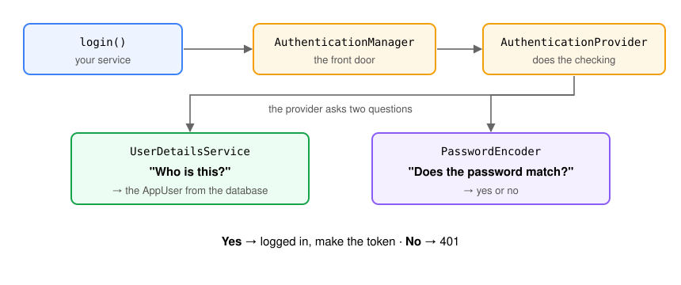

# How a request gets authorised

*Who are you? Are you allowed? Answer both before the controller runs.*

*A guided lesson. Read it start to finish; work the code as you go; stop at the **Pause**
prompts and actually answer them before reading on.*

**Before you start**

- **You need the Recipe API from last session, finished** — PostgreSQL, Liquibase changesets
  `001`–`003`, tags with `TagService` + `TagServiceImpl`, and the paged and filtered searches. Copy it into this session's
  `recipe-api/` folder and continue from there; that folder's `README.md` says how.
- **Network access at the start of the session** — the security starter and JJWT come down from
  Maven Central.
- **PostgreSQL running from the first minute.** The users live in it from checkpoint 3.
- **Java 25 · Spring Boot 4.1.1 · Maven · PostgreSQL · JJWT 0.13.0.**
- **Six checkpoints.** `mvn test` is green when you start and green at the end of every
  checkpoint; what you add today you check with `curl`, jwt.io and the `users` table.

**By the end you'll be able to:**

- Tell **authentication** from **authorisation**, and **401** from **403**
- Explain what happens to an HTTP request **before** it reaches your controller
- Write a `SecurityFilterChain` that opens some URLs and protects the rest
- Store users in PostgreSQL with **BCrypt** hashes, and let people register
- Issue a signed **JWT** at login, and accept it on every request with a filter you wrote
- Protect a URL with `hasRole`, say why that is not enough, and protect the **service method** with
  `@PreAuthorize`
- Say plainly what today's setup still does not do

The title is *How a request gets authorised*, not "Spring Security". The annotations are the easy
part. The useful skill is following one request from the network to your code and saying, for sure,
whether it gets through — and which piece of code decided.

---

## Who you are building for today

**Sunrise Kitchen** is about to put the API online. Today anyone who can reach the server can add,
change and delete recipes — the API has no idea who is calling. **Today it learns to ask.**

The client's requests:

- *"Before we put this online, we need to know who's using it."*
- *"Anyone can browse recipes. To add or change one, you need an account."*
- *"People sign up themselves. Our head chef, Sokha, is the only admin."*
- *"Log in once on the phone — don't make the app keep the password."*
- *"Deleting a recipe is final. Only the head chef can do that."*

---

## Why "just check the user in the controller" fails

The first idea most people have:

```java
@DeleteMapping("/recipes/{id}")
public ResponseEntity<Void> deleteRecipe(@PathVariable Long id,
                                         @RequestHeader("X-User") String user) {
  if (!user.equals("sokha")) {
    return ResponseEntity.status(403).build();
  }
  recipeService.delete(id);
  return ResponseEntity.noContent().build();
}
```

1. **Anyone can send any header.** `curl -H "X-User: sokha"` works for everyone. The code checks a
   *claim*, not a *proof*.
2. **You have to remember it on every endpoint.** Forget it once and that endpoint is open.
3. **It is in the wrong layer.** "Only the head chef deletes" is a business rule — and business
   rules live in the service.
4. **It runs too late.** By the time your method runs, the body has been parsed and validated.

We want a **proof** of identity, **one gate** every request passes through where the default answer
is *no*, and **rules you can read** in one place.

---

## Two words, and two ways to remember a user

| | **Authentication** | **Authorisation** |
|---|---|---|
| Question | *Who are you?* | *Are you allowed to do this?* |
| Answered by | a password, a token, a certificate | rules about URLs, roles and methods |
| Fails with | **401 Unauthorized** — "I don't know who you are" | **403 Forbidden** — "I know who you are, and no" |

"401 Unauthorized" is a historical misname: it means *unauthenticated*. Authentication always comes
first.

Once a user has logged in, how does the server know it is them on the **next** request? HTTP
forgets everything between requests. There are two answers:

| | **Session** (stateful) | **Token** (stateless) |
|---|---|---|
| After login | the server stores a session, gives the browser a cookie | the server signs a token and gives it to the client |
| Every request | browser sends the cookie; server looks the session up | client sends the token; server **checks the signature** |
| Server stores | every session | nothing |
| Scaling to 3 servers | they must share sessions | any server can check any token |
| Fits | server-rendered web pages | APIs called by phones and JavaScript apps |

Think of a session as a **library logbook** — the librarian writes your name in at each visit, which
works for one branch and gets chaotic across fifty. A token is a **stamped library card**: any
branch can check the stamp without calling headquarters.

The Recipe API is called by a mobile app, so it uses **tokens** — specifically, **JWTs**.

### HTTP Basic — it exists, and we skip it

Spring Security also has **HTTP Basic**: the client sends `username:password` (Base64-encoded, not
encrypted) on **every** request. It is what you get by default, and you will see it for one minute
in checkpoint 1. It is fine for a script on `localhost`. For an app it is wrong: the phone would have
to store the password, and the server would check it with BCrypt on every request.

---

## Add the starter, watch everything lock

One dependency, and nothing else:

```xml
<dependency>
    <groupId>org.springframework.boot</groupId>
    <artifactId>spring-boot-starter-security</artifactId>
</dependency>
```

On restart:

- **every endpoint returns 401**, even `GET /recipes`
- **a user called `user` exists**, with a random password in the log
- HTTP Basic and a login form are switched on

This is auto-configuration again — the same thing that started Tomcat when you added the web
starter. The default is the safe one: **lock everything**. You then open what should be open.

**Secure by default** matters. If the default were *open*, every endpoint you forgot would be public
— and it would fail quietly. Locked by default, a forgotten endpoint fails loudly, and someone fixes
it.

---

## Checkpoint 1

*"Before we put this online, we need to know who's using it."*

The security starter, and nothing else. **`recipe-api/README.md`, checkpoint 1.** `mvn test` green.

`curl` `/recipes` with and without the generated password: `401`, then `200`.

---

## The filter chain — what a request passes through

In the aspects session you met three places to put code that runs around your controllers:
**servlet filters**, **interceptors** and **aspects**. Spring Security is mostly the first:
**filters**.

A filter sees every HTTP request before Spring MVC does, and can pass it on — or answer itself. The
trip one request takes:

| Stop | Who | Can it stop the request? |
|---|---|---|
| 1 | Tomcat receives the request | — |
| 2 | **Spring Security's filter chain** | **yes — 401 or 403, and nothing after it runs** |
| 3 | `DispatcherServlet` | — |
| 4 | your controller | — |
| 5 | your service | yes, from checkpoint 6 — `@PreAuthorize` |

Spring Security adds **one** filter to Tomcat. That filter runs **its own chain** of security filters,
in a fixed order. Today's matter:

| Filter | Its job |
|---|---|
| `CsrfFilter` | rejects browser writes without a CSRF token — we switch it off |
| **`JwtAuthenticationFilter`** | **yours**, from checkpoint 5: reads the `Bearer` token |
| `AnonymousAuthenticationFilter` | nobody signed in? mark the request "anonymous" |
| `ExceptionTranslationFilter` | "not signed in" → **401**, "not allowed" → **403** |
| `AuthorizationFilter` | the last gate: checks your URL rules |

**If the chain says no, `DispatcherServlet` never sees the request.** Your controller does not run,
your validation does not run, your service is never called.

### The `SecurityContext`

When an authentication filter is satisfied, it puts an `Authentication` in the **`SecurityContext`**
— "the signed-in user for this request":

| Part of the `Authentication` | Holds |
|---|---|
| `principal` | the user — a `UserDetails` |
| `name` | the user's login name — for us, the email |
| `authorities` | `[ROLE_USER]` |
| `authenticated` | `true` |

Every filter after that, `@PreAuthorize`, and your own controller read the user from there. `GET
/me` in checkpoint 5 takes the email out of exactly this object.

> **Pause.** A request with a forged token reaches your filter. Does it ever reach your
> controller? Which filter decides the status code?

---

## Your own rules — `SecurityFilterChain`

```java
@Bean
SecurityFilterChain securityFilterChain(HttpSecurity http) throws Exception {
  http
      .csrf(csrf -> csrf.disable())
      .sessionManagement(
          session -> session.sessionCreationPolicy(SessionCreationPolicy.STATELESS))
      .authorizeHttpRequests(auth -> auth
          .requestMatchers(HttpMethod.GET, "/recipes/**", "/tags/**").permitAll()
          .requestMatchers("/auth/**", "/error").permitAll()
          .anyRequest().authenticated())
      .exceptionHandling(
          ex -> ex.authenticationEntryPoint(new HttpStatusEntryPoint(HttpStatus.UNAUTHORIZED)));
  return http.build();
}
```

Declare a `SecurityFilterChain` bean and Spring Boot stops installing its own. `HttpSecurity` is a
builder: each call switches a piece on, off, or configures it.

**The rules are read top to bottom, and the first match wins.** Specific rules first;
`anyRequest()` last, as the safety net that catches every URL you forgot to mention.

| Method | Lets through |
|---|---|
| `permitAll()` | everyone |
| `authenticated()` | any signed-in user |
| `hasRole("ADMIN")` | signed in **and** has `ROLE_ADMIN` — you use it in checkpoint 6 |

`/recipes/**` matches `/recipes`, `/recipes/5` and `/recipes/5/tags`; one `*` matches a single path
segment.

### Why CSRF off and `STATELESS`

**CSRF** is an attack on **browsers that carry a session cookie**: a page on `evil.com` makes your
browser send a request to `bank.com`, and the browser attaches the bank's cookie by itself. CSRF
protection makes every write carry a secret token the evil page cannot read. Our API has **no
session and no cookie** — the client attaches its token explicitly — so the attack does not apply,
and the protection would only reject our `POST`s. **A decision, not a shortcut:** a server-rendered
site with a login cookie keeps CSRF on.

**`STATELESS`** tells Spring never to create an HTTP session. Every request proves itself.

### Why the entry point — the missing 401

With no login method configured, Spring Security does not know how to ask anyone to sign in, so its
default answer to an anonymous request is a flat **403**. That is the wrong word: nobody is signed in,
so it must be **401**. One line fixes it:

```java
.exceptionHandling(ex -> ex.authenticationEntryPoint(new HttpStatusEntryPoint(HttpStatus.UNAUTHORIZED)))
```

The **entry point** is what Spring calls when it needs someone to authenticate. You break it on
purpose in checkpoint 2.

> **Pause.** For each, say 401 or 403: (a) `POST /recipes` with no token; (b) `DELETE /recipes/5`
> as Dara, who is a `USER`, once the head chef's rule exists; (c) `GET /me` with an expired token.

---

## Checkpoint 2

*"Anyone can browse recipes. To add or change one, you need an account."*

`security/SecurityConfig` with the rules above. **`recipe-api/README.md`, checkpoint 2.** `mvn test`
green.

`GET /recipes` is `200` again; an anonymous `POST` is `401`. Then comment out the entry point, watch
the `401` turn into a `403`, and put it back.

---

## Users

### Spring Security asks one question

```java
public interface UserDetailsService {
  UserDetails loadUserByUsername(String username) throws UsernameNotFoundException;
}
```

*"Give me everything you know about this user."* Spring Security calls the login name "username";
ours is an email. The answer is a `UserDetails`: the name, the **stored password hash**, and the
authorities. Spring then compares the passwords itself — **you never compare passwords by hand**.

### `AppUser` is the `UserDetails`

`UserDetails` is an interface, and in Spring Security 7 only three of its methods have no default.
So the entity answers the question itself:

```java
public class AppUser implements UserDetails {
  // ...the fields: id, email, passwordHash, fullName, role...

  @Override
  public String getUsername() {
    return email;
  }

  @Override
  public String getPassword() {
    return passwordHash;
  }

  @Override
  public Collection<? extends GrantedAuthority> getAuthorities() {
    return List.of(new SimpleGrantedAuthority("ROLE_" + role.name()));
  }
}
```

The other four — `isAccountNonExpired`, `isAccountNonLocked`, `isCredentialsNonExpired`,
`isEnabled` — default to `true`. Override one the day the client asks for locked accounts.

And the service that answers Spring's question becomes one lookup:

```java
return appUserRepository
    .findByEmail(email)
    .orElseThrow(() -> new UsernameNotFoundException("user email: " + email + " not found"));
```

**Two ways to give Spring a user.** The companion course shows both:

| | Entity implements `UserDetails` (ours) | Map entity → Spring's `User` |
|---|---|---|
| Code | three methods on `AppUser` | `User.withUsername(...).password(...).roles(...).build()` in the service |
| Who is in the `SecurityContext` | **your `AppUser`** — id, name and all | Spring's `User`: a name, a hash, authorities |
| Reading the signed-in user later | one cast, no query | a second database lookup by email |
| Cost | your entity depends on Spring Security | a copy of the user in another class |

We pay the first cost on purpose: from checkpoint 5 the signed-in `AppUser` is one cast away,
anywhere in the request.

### BCrypt — never store the password

A `users` table with plain passwords leaks everyone's password the day anyone reads it — a backup,
a junior with read access, one SQL injection. And people reuse passwords.

So you store a **hash**: easy to compute forward, impossible backward. But not SHA-256: a graphics
card tries **billions** of SHA-256 guesses a second. **BCrypt is slow on purpose**, and more. Read the
seeded hash of `chef1234` left to right:

`$2a$10$AXn5vDlOtZbox9gVlg9CqeuBjZi2XHLi8vLBmkMaqv1Zz5M97LF1y`

| Part | Here | Means |
|---|---|---|
| Algorithm version | `2a` | which BCrypt |
| Cost | `10` | 2¹⁰ rounds — raise it as computers get faster |
| Salt | the next 22 characters | random per password, stored inside the hash |
| Hash | the last 31 characters | the result |

Because the **salt** is random and stored inside the hash, two users with the same password get
**different** hashes. You see that in checkpoint 3.

```java
@Bean
PasswordEncoder passwordEncoder() {
  return new BCryptPasswordEncoder();
}
```

### Roles, and the `ROLE_` prefix

Everything a user may do is an **authority**, a plain string. A **role** is an authority that starts
with `ROLE_`:

| You write | Spring stores or checks |
|---|---|
| `new SimpleGrantedAuthority("ROLE_" + role.name())` in `AppUser` | stores `ROLE_ADMIN` |
| `hasRole("ADMIN")` | checks `ROLE_ADMIN` — **adds** the prefix |
| `hasAuthority("ROLE_ADMIN")` | checks `ROLE_ADMIN` — exactly what you wrote |

The prefix is written **once**, in `getAuthorities()`, because the `Role` enum holds `USER` and
`ADMIN` without it. Everywhere else you write `hasRole("ADMIN")` and Spring adds it. The trap is
either end: forget the prefix in `getAuthorities()` and every `hasRole` says 403 — even to Sokha;
write `hasRole("ROLE_ADMIN")` and Spring refuses to start.

### Registering — the same three layers as a recipe

`POST /auth/register` has the shape `POST /recipes` has had since the REST session:

```java
// AuthController
@PostMapping("/register")
public ResponseEntity<UserResponse> register(@Validated @RequestBody RegisterRequest request) {
  AppUser savedUser = authService.register(userMapper.toAppUser(request), request.password());
  return ResponseEntity.status(HttpStatus.CREATED).body(userMapper.toUserResponse(savedUser));
}
```

```java
// AuthServiceImpl
@Override
@Transactional
public AppUser register(AppUser user, String password) {
  if (appUserRepository.existsByEmail(user.getEmail())) {
    throw new EmailAlreadyExistsException("email: " + user.getEmail() + " already registered");
  }
  user.setPasswordHash(passwordEncoder.encode(password));
  user.setRole(Role.USER);
  return appUserRepository.save(user);
}
```

| Layer | Its part |
|---|---|
| `UserMapper` | `RegisterRequest` → `AppUser` (email and name only), and `AppUser` → `UserResponse` |
| `AuthService` | the rules: the email is free, the password is **hashed**, the role is **always `USER`** |
| `AuthController` | HTTP: the body in, `201` out |

The mapper ignores `passwordHash` and `role` **on purpose**. A typed password is not a hash, and the
client does not choose its own role — both are the service's decisions. The `UserResponse` has **no
password hash in it**. Nobody can register as `ADMIN`: the first admin, Sokha, comes from Liquibase
changeset `004`, like the house recipe came from `002`.

---

## Checkpoint 3

*"People sign up themselves. Our head chef, Sokha, is the only admin."*

Changeset `004`, `Role` and `AppUser`, `AppUserRepository`, `CustomUserDetailsService`, the
`PasswordEncoder`, `UserMapper`, `AuthService` and `POST /auth/register`. **`recipe-api/README.md`,
checkpoint 3.** `mvn test` green.

Register Dara: `201`. Again: `409`. Then read the `users` table — hashes, never passwords.

---

## Break — 10 minutes

---

## JWT

### What it is

A **JSON Web Token** carries its own proof. Think of a **festival wristband**: it proves you came in
legitimately, says what kind of ticket you have, any staff member can check it without calling the
box office — and it expires at the end of the day.

A JWT is three Base64 parts, joined by dots:

| Part | Looks like | Holds |
|---|---|---|
| Header | `eyJhbGciOiJIUzI1NiJ9` | which algorithm signed it |
| Payload | `eyJpc3MiOiJyZWNpcGUtYXBpIiwic3ViIjoiZGFyYUAuLi4ifQ` | the claims |
| Signature | `3kq_L0bQ…` | the proof nobody changed the first two |

Decode the first two parts — they are just Base64 — and you get JSON. This is the real output of
today's `JwtService`:

```json
{"alg":"HS256"}
{"iss":"recipe-api","sub":"sokha@sunrisekitchen.com","role":"ROLE_ADMIN","iat":1792257025,"exp":1792257925}
```

| Claim | Means |
|---|---|
| `iss` | issuer — who made it |
| `sub` | subject — who it is about |
| `role` | our own claim |
| `iat` / `exp` | issued at / expires, in seconds since 1970 |

### Readable by anyone, forgeable by no one

**Base64 is not encryption.** Paste a token into jwt.io and you read every claim. So **never put a
secret in a JWT** — no password, no ID number.

**But nobody can change it.** The signature is computed from the header, the payload and a **secret
only the server knows**:

```
signature = HMAC-SHA256( header + "." + payload , secret )
```

Change one character — `ROLE_USER` to `ROLE_ADMIN` — and when the server recomputes the signature,
it no longer matches. Without the secret you cannot produce the right one. Like a **wax seal**: you
can read the letter through the envelope, but you cannot reseal it.

### The flow

| Step | Request | Answer | The server checks |
|---|---|---|---|
| 1 | `POST /auth/login` with email and password | a signed token | the password, **once**, with BCrypt |
| 2 | `GET /me` with `Authorization: Bearer eyJ...` | `200` | the **signature** — no password, no BCrypt |

### `JwtService` — with JJWT

```java
public String generateToken(UserDetails user) {
  String role = user.getAuthorities().iterator().next().getAuthority();
  Date now = new Date();
  return Jwts.builder()
      .issuer("recipe-api")
      .subject(user.getUsername())
      .claim("role", role)
      .issuedAt(now)
      .expiration(new Date(now.getTime() + expirationMs))
      .signWith(signingKey)
      .compact();
}

public String extractUsername(String token) {
  return parse(token).getSubject();
}

private Claims parse(String token) {
  return Jwts.parser().verifyWith(signingKey).build().parseSignedClaims(token).getPayload();
}
```

`parseSignedClaims` **checks the signature and the expiry before it returns anything**. A forged
token throws `SignatureException`; an expired one throws `ExpiredJwtException`; garbage throws
`MalformedJwtException`. All three are `JwtException`s.

The key comes from configuration:

```properties
app.jwt.secret=${APP_JWT_SECRET:dev-only-secret-change-me-0123456789abcdef}
app.jwt.expiration-ms=900000
```

`${APP_JWT_SECRET:…}` means *the environment variable if it is set, otherwise the default*. Anyone
with the real secret can mint a token saying `ROLE_ADMIN`, so outside your laptop it **always** comes
from the environment. HS256 needs **at least 32 bytes**; JJWT refuses a shorter key at startup with
`WeakKeyException`.

### Logging in — the `AuthenticationManager`

The login endpoint checks a password **in your code**, so it needs Spring's machinery as beans:

```java
@Bean
AuthenticationProvider authenticationProvider() {
  DaoAuthenticationProvider provider = new DaoAuthenticationProvider(userDetailsService);
  provider.setPasswordEncoder(passwordEncoder());
  return provider;
}

@Bean
AuthenticationManager authenticationManager(AuthenticationConfiguration config) throws Exception {
  return config.getAuthenticationManager();
}
```

The **provider** knows *how*: load the user with your `CustomUserDetailsService`, compare with
BCrypt. The **manager** is the front door your service calls.

### How the login pieces fit



Your `login()` only talks to the **`AuthenticationManager`**. The manager passes the job to the
**`AuthenticationProvider`**, and the provider asks two questions: **"who is this?"** — the
`UserDetailsService` loads the `AppUser` — and **"does the password match?"** — the
`PasswordEncoder` compares what was typed with the stored hash. Yes to both: logged in, and `login()`
makes the token. Otherwise: `BadCredentialsException`, and your `GlobalExceptionHandler` answers 401.

| Piece | Its one job | Where it comes from |
|---|---|---|
| `AuthenticationManager` | the front door: `authenticate(attempt)` | a `@Bean` in `SecurityConfig`, built by Spring from the providers |
| `DaoAuthenticationProvider` | check a username and password | a `@Bean` in `SecurityConfig` — you hand it the `UserDetailsService` and the `PasswordEncoder` |
| `UserDetailsService` | find a user by login name | your `CustomUserDetailsService`, a `@Service` |
| `UserDetails` | what Spring needs to know about a user | your `AppUser` entity — `implements UserDetails` |
| `PasswordEncoder` | hash, and compare with a hash | a `@Bean` in `SecurityConfig`: `BCryptPasswordEncoder` |

The JWT filter in checkpoint 5 uses only **one** of these: the `UserDetailsService`. A token is
checked by its signature — there is no password, so no encoder, no manager, no provider.

The login method itself:

```java
@Override
public AuthResponse login(String email, String password) {
  Authentication authentication =
      authenticationManager.authenticate(
          UsernamePasswordAuthenticationToken.unauthenticated(email, password));
  UserDetails user = (UserDetails) authentication.getPrincipal();
  return new AuthResponse(
      jwtService.generateToken(user), "Bearer", jwtService.expirationSeconds(), user.getUsername());
}
```

The service takes the email and the password, not the `LoginRequest` — the request record is the
controller's business, as `CreateRecipeRequest` is. And it returns an `AuthResponse`, not an entity,
because there is no entity: a token is made and handed over, never stored.

A wrong password throws `BadCredentialsException`. So does an **unknown email** — Spring hides the
difference on purpose, so nobody can probe which emails have accounts. Your `GlobalExceptionHandler`
turns both into the same 401.

> **Pause.** Dara opens jwt.io, changes her `exp` to next year, and sends the token. What
> happens, and which line stops her?

---

## Checkpoint 4

*"Log in once on the phone — don't make the app keep the password."*

JJWT, the two properties, `JwtService`, the provider and the manager, `login` in the service and
`POST /auth/login`. **`recipe-api/README.md`, checkpoint 4.** `mvn test` green.

Log in as Dara and read the token on jwt.io. Then send it with a `POST` — still `401`: nothing reads
tokens yet.

---

## Accepting the token — the filter you write

```java
@Override
protected void doFilterInternal(
    HttpServletRequest request, HttpServletResponse response, FilterChain filterChain)
    throws ServletException, IOException {

  String authHeader = request.getHeader("Authorization");
  if (authHeader == null || !authHeader.startsWith("Bearer ")) {
    filterChain.doFilter(request, response);
    return;
  }

  String token = authHeader.substring(7);
  try {
    String email = jwtService.extractUsername(token);
    UserDetails user = userDetailsService.loadUserByUsername(email);

    UsernamePasswordAuthenticationToken authentication =
        new UsernamePasswordAuthenticationToken(user, null, user.getAuthorities());
    authentication.setDetails(new WebAuthenticationDetailsSource().buildDetails(request));
    SecurityContextHolder.getContext().setAuthentication(authentication);
  } catch (JwtException | UsernameNotFoundException e) {
    SecurityContextHolder.clearContext();
  }

  filterChain.doFilter(request, response);
}
```

What it does with each request, in order:

| Step | Question | No | Yes |
|---|---|---|---|
| 1 | `Authorization: Bearer ...` present? | carry on as anonymous | go to 2 |
| 2 | signature and expiry check out? | stay anonymous | go to 3 |
| 3 | load the user from the database | — | put them in the `SecurityContext` |
| 4 | carry on | `AuthorizationFilter` checks the rules, then the controller | |

**The filter never answers by itself.** A missing or broken token just leaves the request
anonymous; the URL rules and the entry point turn that into 401 where it matters, and a public
`GET` still works.

**It extends `OncePerRequestFilter`** so it runs once per request, even if the request is forwarded
inside the server.

**Why load the user from the database on every request?** The token alone says who and what role.
Loading the user costs one query, and buys two things: a deleted user is out at once, and a changed
role counts on the next request. Systems that skip the lookup trade that away for speed.

**Wiring it in:**

```java
.addFilterBefore(jwtAuthenticationFilter, UsernamePasswordAuthenticationFilter.class);
```

*Run my filter before Spring's own username-and-password filter* — so the user is known by the time
`AuthorizationFilter` checks the rules at the end of the chain.

### `GET /me` — a clean controller, and the `SecurityContext` in the service

```java
// UserController
@GetMapping("/me")
public ResponseEntity<UserResponse> me() {
  return ResponseEntity.ok(userMapper.toUserResponse(userService.getCurrentUser()));
}
```

```java
// UserServiceImpl
@Override
public AppUser getCurrentUser() {
  Authentication authentication = SecurityContextHolder.getContext().getAuthentication();
  return (AppUser) authentication.getPrincipal();
}
```

The controller has no security code in it: a URL, a `200`, the mapper — like every endpoint since
the REST session. The question *who is signed in?* is answered in the service, from the same
`SecurityContext` your filter filled: `SecurityContextHolder.getContext().getAuthentication()`
hands back the `Authentication`, and its **principal** is the `UserDetails` the filter loaded
through `CustomUserDetailsService` — your own `AppUser`. One cast, and no second query: the filter
already read Dara's row at the start of this request.

**How can a service read it, when nobody passed it in?** `SecurityContextHolder` keeps one
`SecurityContext` **per thread**, and one request runs on one thread from the filter to the
service. So your filter, your controller and your service all see the same user — and the request
next to it, on another thread, sees its own.

| Where the user is read | Controller | Service |
|---|---|---|
| Today's choice | — | `SecurityContextHolder.getContext().getAuthentication()` |
| The controller becomes | one line, HTTP only | |
| The price | | `getCurrentUser()` only has an answer **inside a signed-in request** |

The price is real. Called from a scheduled job, or from a test that never signed anyone in,
`getAuthentication()` is `null`. In a test, use `@WithUserDetails("dara@sunrisekitchen.com")`: it
loads the real `AppUser` through your `CustomUserDetailsService`. `@WithMockUser` puts Spring's own
`User` in the context instead, and the cast fails. The other way exists too: Spring can hand the
controller an `Authentication` parameter, and the controller passes it down. Both are common; this
course keeps the controller clean.

> **Pause.** After checkpoint 5, `curl -u user:<generated password> /recipes/1` — the HTTP Basic
> request from checkpoint 1 — and a `POST` with it. What do you get, and why?

---

## Checkpoint 5

*"So — the app sends that token, and it's in. And the app needs to ask who is signed in."*

`JwtAuthenticationFilter`, `.addFilterBefore(...)`, `UserService` and `GET /me`.
**`recipe-api/README.md`, checkpoint 5.** `mvn test` green.

`/me` with Dara's token answers with Dara. Then two breaks: change her role on jwt.io and send the
forged token; set the lifetime to 30 seconds and wait. `401` both times.

---

## Who may delete — on the URL, then on the action

The client's last rule: *only the head chef deletes a recipe.* You already have a place where rules
live — the URL rules in `SecurityConfig`. Start there.

### A rule on the URL — `hasRole`

```java
.authorizeHttpRequests(auth -> auth
    .requestMatchers(HttpMethod.GET, "/recipes/**", "/tags/**").permitAll()
    .requestMatchers("/auth/**", "/error").permitAll()
    .requestMatchers(HttpMethod.DELETE, "/recipes/**").hasRole("ADMIN")
    .anyRequest().authenticated())
```

One line, **above** `anyRequest()` because the first match wins. Nobody gets 401, Dara gets 403,
Sokha gets 204. It works, it is easy to read, and every rule is still in one file.

### The second door

A month later the mobile team asks for a "remove" button, and somebody writes:

```java
@PostMapping("/{id}/remove")
public ResponseEntity<Void> removeRecipe(@PathVariable Long id) {
  recipeService.delete(id);
  return ResponseEntity.noContent().build();
}
```

Dara presses it. **204 — the recipe is gone.** Nothing is broken: the URL rule says
`DELETE /recipes/**`, and this is a `POST` to another URL, so `anyRequest().authenticated()` lets any
signed-in user through. The controller then calls the very same `delete`.

URL rules protect **URLs**. The client's rule is about an **action**: whichever URL leads to it,
today's or next month's. Every one of those URLs ends in one method — `RecipeService.delete` — so
the rule goes on the method.

### A rule on the action — `@PreAuthorize`

```java
@Override
@Transactional
@PreAuthorize("hasRole('ADMIN')")
public void delete(Long id) {
  recipeRepository.deleteById(id);
}
```

Plus `@EnableMethodSecurity` on `SecurityConfig` to switch it on — and the `DELETE` URL line comes
out, so the rule has one home, not two. Both doors now answer 403 to Dara.

| | URL rule — `hasRole(...)` in the chain | Method rule — `@PreAuthorize` |
|---|---|---|
| Guards | one HTTP method on one URL pattern | one Java method, from any caller |
| Runs | in the filter chain, before the controller | on the service's proxy, after the controller |
| Good for | broad strokes — "writes need a signed-in user" | business rules — "only the head chef deletes" |
| Misses | the same action reached another way | calls from inside the same class |

Expressions you will meet:

| Expression | Means |
|---|---|
| `hasRole('ADMIN')` | has `ROLE_ADMIN` |
| `hasAnyRole('ADMIN', 'EDITOR')` | either |
| `isAuthenticated()` | anybody signed in |
| `#email == authentication.name` | the argument is the caller's own email |

### It is an aspect

How does an annotation stop a method? **A proxy** — the same one the aspects session put around
`RecipeServiceImpl` for `ServiceCallAspect`. `@EnableMethodSecurity` registers an aspect around every
bean with `@PreAuthorize`. When the controller calls `delete`, it calls the proxy first, and the
proxy asks: *is `ROLE_ADMIN` in the `SecurityContext`?* No → `AccessDeniedException` → 403. Yes →
the real `delete` runs.

So the aspects session's limits apply: a call from **inside the same class** (`this.delete(id)`)
skips the check; only calls from another bean go through the proxy.

**Why 403 and not 500?** The `AccessDeniedException` travels out of Spring MVC to
`ExceptionTranslationFilter`. Your `GlobalExceptionHandler` lets it pass because it only handles
specific exceptions. A catch-all `@ExceptionHandler(Exception.class)` would grab it and answer 500.

> **Pause.** A developer adds `cleanUpOld()` to `RecipeServiceImpl`, which loops and calls
> `delete(id)`. Dara calls the endpoint that runs it. Is she stopped?

---

## Checkpoint 6

*"Deleting a recipe is final. Only the head chef can do that."*

The `hasRole` line, the second door, then `@EnableMethodSecurity` and `@PreAuthorize`.
**`recipe-api/README.md`, checkpoint 6.** `mvn test` green.

`DELETE` as nobody, Dara and Sokha: `401`, `403`, `204` — with the URL rule, and again with the
method rule. In between, Dara walks through the second door with a `204`; afterwards it answers
`403`.

---

## JWT practices

| Do | Don't |
|---|---|
| use HTTPS — a token is as good as a password while it lives | put secrets in the payload |
| keep access tokens short (15 minutes) | use a short or guessable secret |
| keep the secret in an environment variable | log tokens |
| check the signature **and** the expiry — `parseSignedClaims` does both | trust a claim you did not check |

**Where the client keeps it:**

| Storage | Readable by injected JavaScript (XSS)? | Sent automatically (CSRF)? | Verdict |
|---|---|---|---|
| `localStorage` | yes | no | avoid |
| `sessionStorage` | yes | no | better, not good |
| `HttpOnly` cookie | no | **yes** — CSRF is back | good, with CSRF protection |
| memory, plus a refresh token | no | no | best |

That last row needs a **refresh token** — next session.

---

## What you have *not* learned

Today's API is more secure than this morning's. It is still not finished.

| Missing | Why it matters | Where |
|---|---|---|
| **Refresh tokens** | After 15 minutes Dara must type her password again | next session |
| **Logout** | A token works until it expires; nothing can cancel it yet | next session |
| **CORS** | A browser app on another port cannot call the API at all | next session, shown in class |
| **Error bodies** | A 401 from the filter has an empty body, unlike your ProblemDetails | next session, shown in class |
| **OAuth2** | Letting GitHub log people in, so they need no new password for us | next session |
| **HTTPS** | Without it, anyone on the network reads the token | the shipping hour, and a reverse proxy |
| **Rate limiting** | Nothing stops a thousand password guesses a minute at `/auth/login` | — |
| **Password reset, email checks** | Real sign-up needs both | — |

**The failure mode to avoid** is a developer who can put `@PreAuthorize` on a method but cannot say
whether an endpoint is protected. You can: follow the request through the chain, name the filter
that answers, prove it with `curl`.

---

## What you now know that you did not

| Before today | Now |
|---|---|
| Anyone who reached the server could change anything | The starter locks everything; you open what should be open |
| A request went straight to your controller | It passes Spring Security's **filter chain** first — refused there, your code never runs |
| 401 and 403 were two error numbers | **401** = who are you; **403** = I know, and no. An **entry point** makes "not signed in" a 401 |
| A user was a header anyone could send | A row in `users`, a **BCrypt** hash, a role nobody can give themselves |
| Logging in meant sending the password every time | Once, at `/auth/login`, for a signed **JWT** — readable by anyone, changeable by no one |
| Spring's filters were someone else's code | **Your filter** reads `Bearer`, checks, loads the user, fills the `SecurityContext`, and never answers by itself |
| A rule on a URL felt like enough | `hasRole` guards a door; `@PreAuthorize` guards the **action**, as an aspect on a proxy |

**Next session:** stay signed in with refresh tokens, sign out for real, log in with GitHub, let a
browser call the API — and then ship it all in containers.

---

## Extra learning material — testing the rules

> Optional. Not done in class.

In Spring Boot 4 the security test helpers have their own starter:

```xml
<dependency>
  <groupId>org.springframework.boot</groupId>
  <artifactId>spring-boot-starter-security-test</artifactId>
  <scope>test</scope>
</dependency>
```

`@WithMockUser` runs a test as a pretend signed-in user — no token, no database user:

```java
@SpringBootTest
@AutoConfigureMockMvc
class RecipeSecurityTest {

  @Autowired MockMvc mockMvc;

  @Test
  void anyoneCanRead() throws Exception {
    mockMvc.perform(get("/recipes")).andExpect(status().isOk());
  }

  @Test
  void nobodyCannotCreate() throws Exception {
    mockMvc.perform(post("/recipes").contentType("application/json").content("{}"))
        .andExpect(status().isUnauthorized());
  }

  @Test
  @WithMockUser(roles = "USER")
  void userCannotDelete() throws Exception {
    mockMvc.perform(delete("/recipes/1")).andExpect(status().isForbidden());
  }
}
```

Write one test per row of the README's final table, and a changed rule will fail the build instead
of silently opening a door. `@SpringBootTest` starts the whole app, so these need PostgreSQL running.
